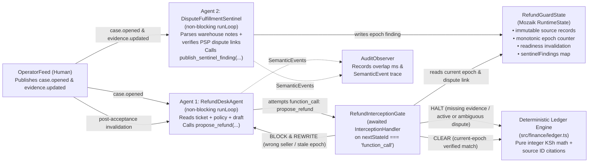

# RefundGuard

**Concurrent Mozaik AI agents with mid-flight `InterceptionHandler` gating that prevent wrong-seller refund misallocations, stale post-acceptance approvals, and unsafe cross-system refund proposals before marketplace payouts release.**

Built solo for the **JigJoy Black Friday AI Hackathon (26-27 November 2026, Agents in Finance)** on `@mozaik-ai/core@6.0.0`.

---

## The Finance Problem

Two costly marketplace payout failures slip past standard batch-total reconciliation:

1. **Zero-Sum Wrong-Seller Misallocation:** A customer buys two KSh 10,000 items from **Seller A** and **Seller B** in one checkout (`CHK-402`). The processor confirms a KSh 10,000 refund and settles **KSh 90,000** net for the batch. The payout draft pays **A: KSh 60,000 / B: KSh 30,000**, which **balances exactly to KSh 90,000** and passes batch-total checks, even though unstructured warehouse notes prove **Seller A's** jacket came back (`A: KSh 50,000 / B: KSh 40,000`). If a late QC warehouse correction arrives mid-review or even after initial acceptance, any superseded approval must expire immediately.
2. **Unsafe Cross-System Refund Proposals During Active Disputes:** While card processors such as Stripe already restrict issuing a refund on the same charge once a dispute is open ([Stripe Disputes Docs](https://docs.stripe.com/disputes/how-disputes-work#during-the-dispute)), marketplace support desks, OMS queues, and seller-payout drafts operate across separate systems. RefundGuard verifies payment linkage (`cardLast4`, checkout/settlement reference, amount within capture, and `status === "OPEN"`) before blocking an unsafe cross-system refund or payout proposal, asks an operator to verify ambiguous partial matches, and ignores unrelated or closed disputes.

---

## Verified Live OpenAI Run (`traces/live-run-trace.json`)

In addition to deterministic offline tests for zero-key judge reproducibility, RefundGuard has been verified end-to-end against live **OpenAI `gpt-4o-mini`** via `@mozaik-ai/core@6.0.0` (full trace committed in [`traces/live-run-trace.json`](traces/live-run-trace.json)):

- **Command:** `node --import tsx src/live-trace.ts case-2-wrong-seller-zerosum`
- **Mode / Model:** `live` / `gpt-4o-mini`
- **Real concurrent execution overlap:** **`5,454ms` (5.45s)** (`RefundDesk [34ms..8147ms]` overlapped `DisputeFulfillmentSentinel [37ms..5491ms]`)
- **Live tool calls:** Both `DisputeFulfillmentSentinel` (`publish_sentinel_finding`) and `RefundDeskAgent` (`propose_refund`) executed real model tool calls.
- **Live interception & re-plan:** `RefundInterceptionGate` blocked `gpt-4o-mini`'s wrong `SELLER-B` proposal at `+4466ms` (`WRONG_SELLER_ALLOCATION`), injected Sentinel's verified `LINE-402-A` / `WH-202` finding, and `gpt-4o-mini` revised and submitted `SELLER-A` (`CORRECTED_READY_FOR_APPROVAL`, total unchanged at KSh 90,000).

---

## How Our Agents Run Concurrently on Mozaik

RefundGuard uses `@mozaik-ai/core@6.0.0`'s concurrency primitives, not a sequential pipeline and not one chatbot with tools:



### Key Concurrency & Safety Invariants
- **Two distinct unstructured reasoning tasks:** `RefundDeskAgent` interprets customer support tickets and return policy; `DisputeFulfillmentSentinel` concurrently interprets free-text warehouse intake notes (including negation and reused boxes) and correlates incoming PSP dispute payloads.
- **True non-blocking overlap (single checkout & multi-checkout batch):** `case.opened` fans out synchronously to both agents' `SituationHandler`s (`AuditObserver` measures actual overlap on every run). In **Black Friday Batch Desk** (`GET /api/batch`), 4 distinct multi-seller checkouts (8 Kenyan sellers across `CHK-402`, `CHK-518`, `CHK-629`, `CHK-741`) run concurrently across 8 Mozaik agent loops, auto-clearing clean checkouts while quarantining exceptions for human **Approve / Hold / Reject** sign-off.
- **Pre-execution `InterceptionHandler` (`RefundInterceptionGate`):** Hooks `nextStateId === "function_call"` (`propose_refund`), awaits Sentinel for the latest `epoch`, and blocks/rewrites wrong-seller or stale-epoch proposals or halts fail-closed on missing evidence, active linked disputes, or ambiguous dispute matches.
- **Real-time live mid-run interrupt:** `POST /api/sessions/:sessionId/inject` injects late QC warehouse corrections or dispute webhooks directly into an actively running Mozaik session while agents are in flight.
- **Post-acceptance readiness invalidation:** If relevant evidence changes *after* `proposal.accepted`, `RefundGuardState` immediately archives the prior proposal as superseded, clears readiness, increments `epoch`, and requires revalidation. Before returning any ready verdict, [`runRefundGuardCase`](src/engine/run-case.ts) verifies that both `acceptedProposal.epoch` and `sentinelFinding.epoch` match `state.epoch`; if revalidation cannot complete, it fails closed to `PENDING_REVALIDATION`.

---

## Quickstart (Reproducible Zero-Key Path + Live Model Runner)

Requires **Node.js 20+** (tested on Node 22 & Node 26).

```bash
npm install
npm test          # 14 automated tests (6 core + 6 audit regressions + batch + live interrupt)
npm run compare   # Ticket+Draft vs 1-Agent Snapshot vs Concurrent RefundGuard
npm start         # Interactive dark UI on http://localhost:3000
```

### Launcher Fallback (`node --import tsx`)
If your environment hits an IPC error running the `tsx` CLI directly, invoke Node's loader flag instead:

```bash
node --import tsx src/server.ts
node --import tsx src/compare.ts
node --import tsx src/cli.ts case-4-late-correction-midflight
```

### Live Model Verification (`npm run trace:live`)
- **Offline judge reproducibility (default):** When no API key is configured, RefundGuard runs on `RefundGuardMockRunner` (a Mozaik `InferenceRunner` modeled on `mozaik-examples/custom-inference-runner`) that parses order lines, warehouse notes, tickets, disputes, and interception feedback dynamically.
- **Real provider run:** Set `OPENAI_API_KEY`, `ANTHROPIC_API_KEY`, or `GEMINI_API_KEY` in `.env` (see [`.env.example`](.env.example)), then capture a real model trace:

```bash
node --import tsx src/live-trace.ts case-2-wrong-seller-zerosum
```

---

## 90-Second Demo Flow

1. Run `npm start` (or `node --import tsx src/server.ts`) and open `http://localhost:3000`.
2. **Open on the KSh 90,000 zero-sum batch (Case 4, default view):** Draft payouts are **A: KSh 60,000 / B: KSh 30,000** (total KSh 90,000). Show the **Concurrent Execution Timeline** where `RefundDeskAgent` and `DisputeFulfillmentSentinel` overlap, then watch the late QC warehouse correction arrive (`epoch 1 -> 2`), expire the stale Seller B proposal (`SUPERSEDED_EVIDENCE`), and recompute payouts to **A: KSh 50,000 / B: KSh 40,000** while the total still balances at **KSh 90,000**.
3. **Show the formatted Source Evidence Cards** directly below the ledger: point to `WH-404-V1`, `WH-404-V2`, `STL-PAY-402`, and `STL-REF-402`.
4. *(Optional live click)* Enable **Live Interrupt Window**, click **Run Review** on Case 1, and click **Interrupt: Dispute** mid-run to fire a live `POST /api/sessions/:id/inject` event while agents are executing, OR switch to **Black Friday Batch Desk (4 Checkouts)** to show 8 concurrent agent loops auto-clearing `CHK-518` and quarantining `CHK-402`, `CHK-629`, and `CHK-741` with live Approve/Hold/Reject buttons.
5. **Show a negative control:** On Case 1, select **Unrelated dispute (card 8812 / ref 999)** -> confirm it is ignored (`READY_FOR_HUMAN_APPROVAL`), or click **Case 3 (Missing Evidence)** for a fail-closed hold.
6. End with `npm test` (14/14 passing) and `npm run compare`.

---

## Fair Baseline Comparison (`npm run compare`)

To avoid conflating evidence access with concurrency, `npm run compare` runs **two explicitly labeled baselines** alongside RefundGuard (without summing artificial penalties across synthetic fixtures):

| Scenario | Ticket-and-Draft Baseline *(no warehouse/dispute feed)* | 1-Agent Snapshot Baseline *(same `t=0` ticket, draft, warehouse, dispute & policy)* | RefundGuard *(2 concurrent Mozaik agents + `InterceptionGate`)* | Concurrent Overlap |
| :--- | :--- | :--- | :--- | :---: |
| 1. Clean Pass | PASS (`SELLER-A`) | PASS (`SELLER-A`) | PASS (`SELLER-A`) | YES |
| 2. Zero-Sum Trap | FAIL (`SELLER-B`) | PASS (`SELLER-A`) | PASS (`SELLER-A`) | YES |
| 3. Missing Evidence | FAIL (`SELLER-B`) | PASS (`HOLD_MISSING_EVIDENCE`) | PASS (`HOLD_MISSING_EVIDENCE`) | YES |
| 4. Mid-Flight Correction | FAIL (`SELLER-B`) | FAIL (`SELLER-B` stale `epoch 1`) | PASS (`SELLER-A` at `epoch 2`) | YES |
| 5. Dispute Collision | FAIL (`SELLER-A`) | FAIL (`SELLER-A` unsafe refund) | PASS (`FROZEN_DISPUTE_COLLISION`) | YES |
| **Score** | **1 / 5** | **3 / 5** *(isolates concurrency to mid-flight Cases 4 & 5)* | **5 / 5** | **5 / 5** |

---

## Financial Grounding & Explicit Hold Policy

- **Zero LLM arithmetic:** All amounts are integer Kenyan Shillings (KSh) computed in [`src/finance/ledger.ts`](src/finance/ledger.ts).
- **Requested Refund vs. Held Reserve:** RefundGuard always reports `requestedRefundKsh` separately from `heldReserveKsh` along with `holdPolicyExplanation`:
  - **Active linked dispute (`FROZEN_DISPUTE_COLLISION`)** with an identified seller line: blocks the unsafe cross-system refund proposal and holds only that seller's disputed checkout line (leaving the undisputed seller payout clear).
  - **Missing evidence / ambiguous dispute / pending revalidation:** holds unsettled checkout lines in reserve because seller attribution is unresolved, while clearly displaying the requested refund separately.
- **Synthetic data only:** All orders, settlements, seller accounts, warehouse notes, and disputes are synthetic. No real accounts or money movement occur.

---

## Project Structure

```text
src/
  finance/
    types.ts           # Immutable source records, dispute match, verdict & ledger types
    dispute-match.ts   # Deterministic payment-to-dispute linkage verifier
    ledger.ts          # Pure deterministic integer-KSh calculator & explicit hold policy
    fixtures.ts        # 5 core scenarios + unrelated/ambiguous dispute fixtures
    batch.ts           # 4-checkout, 8-seller Black Friday batch fixtures
  mozaik/
    runtime.ts         # RefundGuardState (RuntimeState), epoch & readiness invalidation
    interception.ts    # Awaited InterceptionHandler on `propose_refund`
    runner.ts          # Dual live LLM / dynamic deterministic MockInferenceRunner config
    agents/
      refund-desk.ts   # Agent 1: ticket + policy -> propose_refund (+ revalidation loop)
      sentinel.ts      # Agent 2: warehouse notes + dispute links -> publish_sentinel_finding
      observer.ts      # AuditObserver measuring concurrent overlap & SemanticEvents
  engine/
    run-case.ts        # Concurrent Mozaik runner + live session hook + readiness invariant
    run-batch.ts       # Concurrent 4-checkout batch runner (8 parallel agent loops)
    baseline.ts        # Ticket-and-Draft Baseline + fair 1-Agent Snapshot Baseline
  cli.ts               # Terminal runner (`npm run cli`)
  compare.ts           # Three-way benchmark (`npm run compare`)
  live-trace.ts        # Real provider verification harness (`npm run trace:live`)
  server.ts            # Node HTTP + SSE server with /api/batch and /api/sessions/:id/inject
public/
  index.html           # Obsidian dark UI with Batch Desk, Source Cards & Live Interrupts
traces/
  live-run-trace.json  # Verified live OpenAI gpt-4o-mini concurrent trace (5,454ms overlap)
tests/
  refund-guard.test.ts # 14 Vitest tests (`npm test`)
```
