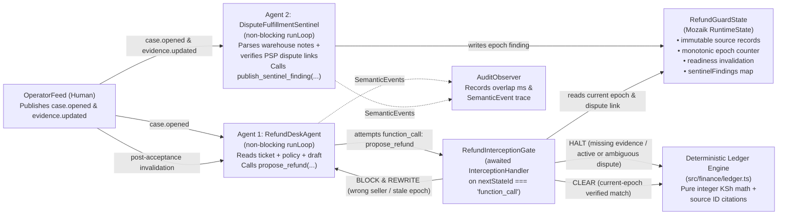

# RefundGuard

**Concurrent Mozaik AI agents with awaited pre-execution interception that prevent wrong-seller refund misallocations, stale post-acceptance approvals, and unsafe cross-system refund proposals before marketplace payouts release.**

| Submission Detail | Value |
| :--- | :--- |
| **Event & Track** | JigJoy Black Friday AI Hackathon (26-27 November 2026, Agents in Finance) |
| **Runtime** | `@mozaik-ai/core@6.0.0` (TypeScript, Node.js 20+) |
| **Concurrency Model** | 2 concurrent `Agent` loops per checkout (8 parallel loops in Batch Desk) + shared `RuntimeState` + reactive `SituationHandler`s + awaited `InterceptionHandler` + `AuditObserver` |
| **Live LLM Proof** | Verified end-to-end on OpenAI `gpt-4o-mini` (`5,454ms` real concurrent overlap, [`traces/live-run-trace.json`](traces/live-run-trace.json)) |
| **Judge Reproducibility** | Zero API key required out of the box (`npm install && npm test && npm start`); live OpenAI / Anthropic / Gemini enabled automatically via `.env` |
| **Automated Verification** | **14 / 14** Vitest tests passing (core cases, audit regressions, 4-checkout batch, live mid-run interrupt) |
| **Data Safety** | 100% synthetic orders, settlements, warehouse notes, and disputes; no real customer data, accounts, or money movement |

---

## 1. The Finance Problem & Real-World Platform Gap

Traditional payment reconciliation verifies that **totals match** (`sum(seller_payouts) == bank_settlement`), which leaves two high-cost Black Friday marketplace failures exposed:

1. **Zero-Sum Wrong-Seller Misallocation:** A customer buys two KSh 10,000 items from **Seller A** and **Seller B** in a single checkout (`CHK-402`). The processor confirms a KSh 10,000 refund and settles **KSh 90,000** net for the batch. The payout draft pays **A: KSh 60,000 / B: KSh 30,000**, which **balances to the exact shilling (KSh 90,000)** and passes total reconciliation, even though unstructured warehouse notes prove **Seller A's** jacket physically came back (supported allocation: **A: KSh 50,000 / B: KSh 40,000**, total still KSh 90,000). If a late QC warehouse inspection arrives while review is running (or even after initial acceptance), any approval based on superseded evidence must expire immediately.
2. **Unsafe Cross-System Refund Proposals During Active Disputes:** Card processors such as Stripe already restrict issuing a refund on the same charge once a dispute is open ([Stripe Disputes Docs](https://docs.stripe.com/disputes/how-disputes-work#during-the-dispute)), and Adyen validates split instruction syntax rather than physical return truth ([Adyen Split Refunds](https://docs.adyen.com/marketplaces/split-transactions/split-refunds)). In real marketplaces, however, customer support desks, OMS refund queues, 3PL warehouse notes, and seller payout drafts operate across separate systems. RefundGuard deterministically verifies payment-to-dispute linkage (`status === "OPEN"`, `cardLast4`, checkout/settlement reference, and amount within capture) before blocking an unsafe cross-system refund or payout proposal, asks an operator to verify ambiguous partial matches, and ignores unrelated or closed disputes.

---

## 2. How Our Agents Run Concurrently on Mozaik

RefundGuard is built natively on `@mozaik-ai/core@6.0.0`'s reactive concurrency model (not a sequential chain and not a single chatbot with tools):



### Mozaik Primitive Mapping (Code-Level Reference)

| Mozaik Primitive | Implementation | Role in RefundGuard |
| :--- | :--- | :--- |
| `defineRuntime<RefundGuardState>()` | [`src/mozaik/runtime.ts`](src/mozaik/runtime.ts) | Creates an isolated runtime per checkout session with shared mutable `RefundGuardState` (`epoch`, `sentinelFindings`, `supersededProposals`, `interceptions`, `timeline`). |
| Non-blocking `runLoop` + `SituationHandler` | [`src/mozaik/agents/refund-desk.ts`](src/mozaik/agents/refund-desk.ts), [`src/mozaik/agents/sentinel.ts`](src/mozaik/agents/sentinel.ts) | `case.opened` fans out synchronously to both agents, launching two independent `runLoop`s in parallel. `evidence.updated` wakes Sentinel on mid-flight updates and triggers RefundDesk revalidation if an earlier approval was invalidated. |
| Awaited `InterceptionHandler` | [`src/mozaik/interception.ts`](src/mozaik/interception.ts) | Passed as the 4th argument to `RefundDeskAgent`'s `runLoop`. Hooks `nextStateId === "function_call"` (`propose_refund`), awaits Sentinel for the latest `epoch`, and blocks/rewrites wrong-seller or stale-epoch calls (appending `[call, blockedToolOutput]` for strict live OpenAI/Anthropic/Gemini tool-call protocol validity) or halts fail-closed into `model_message`. |
| `AuditObserver` (`createHuman`) | [`src/mozaik/agents/observer.ts`](src/mozaik/agents/observer.ts) | Listens to `model.answer`, `interception.started`, and `interception.finished` `SemanticEvent`s and measures exact millisecond overlap between both agents' execution windows. |
| Custom `InferenceRunner` | [`src/mozaik/runner.ts`](src/mozaik/runner.ts) | Auto-selects real Mozaik live models (`gpt-5.4-mini`, `claude-haiku-4-5`, `gemini-3.5-flash`, or custom `gpt-4o-mini`) when an API key is set, or falls back to `RefundGuardMockRunner` (dynamic prompt parser) for zero-key judge verification. |

### Core Safety Invariants
1. **Strict Current-Epoch Readiness Invariant ([`src/engine/run-case.ts`](src/engine/run-case.ts)):** A ready verdict (`READY_FOR_HUMAN_APPROVAL` or `CORRECTED_READY_FOR_APPROVAL`) is never returned unless `acceptedProposal.epoch === state.epoch`, `sentinelFinding.epoch === state.epoch`, `sentinelFinding.status === "VERIFIED_RETURN"`, `acceptedProposal.debitSellerId === sentinelFinding.verifiedSellerId`, and no active or ambiguous linked dispute exists. If a post-acceptance update arrives and revalidation cannot finish, the system fails closed to `PENDING_REVALIDATION`.
2. **Deterministic Payment-to-Dispute Verification ([`src/finance/dispute-match.ts`](src/finance/dispute-match.ts)):** Only freezes on `VERIFIED_ACTIVE_MATCH` (`status === "OPEN"`, matching `cardLast4`, matching checkout suffix or `paymentSettlementId`, and amount within capture). Partial/conflicting signals route to `VERIFY_DISPUTE_MATCH`; unrelated or closed disputes are ignored without disturbing clean checkouts.
3. **Zero LLM Arithmetic ([`src/finance/ledger.ts`](src/finance/ledger.ts)):** LLMs parse unstructured text only. All shilling totals, deltas, reserves, and source citations are computed strictly by pure integer TypeScript functions.

---

## 3. Verified Live OpenAI Run (`gpt-4o-mini`)

RefundGuard was verified end-to-end against live OpenAI **`gpt-4o-mini`** with the full unedited trace committed at [`traces/live-run-trace.json`](traces/live-run-trace.json):

```text
Command:  node --import tsx src/live-trace.ts case-2-wrong-seller-zerosum
Mode:     live | Model: gpt-4o-mini
Verdict:  CORRECTED_READY_FOR_APPROVAL | Final Debit: SELLER-A
Sentinel tool called:   true  (publish_sentinel_finding at +2829ms -> SELLER-A / LINE-402-A)
Desk tool submitted:    true  (revised propose_refund -> SELLER-A after interception)
Wrong proposal blocked: true  (RefundInterceptionGate blocked SELLER-B at +4466ms)
Concurrent overlap:     true  (RefundDesk [34ms..8147ms] overlapped DisputeFulfillmentSentinel [37ms..5491ms] for 5454ms)
```

---

## 4. Quickstart & Judge Verification Commands

Requires **Node.js 20+** (verified on Node 22 & Node 26). No API key is required for full verification.

```bash
git clone https://github.com/Grolds-Code/refund-guard.git
cd refund-guard
npm install
```

### Standard Commands
```bash
npm run typecheck   # Strict TypeScript check (0 errors)
npm test            # 14 automated tests (core, regressions, 4-checkout batch, live interrupt)
npm run compare     # 3-way benchmark: Ticket+Draft vs 1-Agent Snapshot vs RefundGuard
npm start           # Interactive dark UI (desktop & mobile responsive) on http://localhost:3000
npm run cli         # Run all 5 scenarios in terminal
```

### Launcher Fallback (`node --import tsx`)
If your environment hits an IPC pipe error invoking the `tsx` CLI wrapper directly, use Node's `--import tsx` loader:

```bash
node --import tsx src/server.ts
node --import tsx src/compare.ts
node --import tsx src/cli.ts case-4-late-correction-midflight
node --import tsx src/live-trace.ts case-2-wrong-seller-zerosum
```

### Running With a Real LLM Provider
Copy `.env.example` to `.env` and supply any one of `OPENAI_API_KEY`, `ANTHROPIC_API_KEY`, or `GEMINI_API_KEY`:

```env
OPENAI_API_KEY=sk-...
REFUND_GUARD_MODE=live
REFUND_GUARD_MODEL=gpt-4o-mini
```

Then capture a fresh live trace:
```bash
node --import tsx src/live-trace.ts case-2-wrong-seller-zerosum
```

---

## 5. Multi-Checkout Black Friday Batch Desk (`BATCH-BF-2026-01`)

Switch to **Black Friday Batch Desk (4 Checkouts)** in the top bar (or hit `GET /api/batch`) to run 4 distinct multi-seller checkouts across 8 Kenyan sellers concurrently (8 parallel Mozaik agent loops):

| Checkout | Sellers | Case Type | Expected Verdict | Supported Release | Reserve Held |
| :--- | :--- | :--- | :--- | ---: | ---: |
| `CHK-402` | Nairobi Streetwear Co. / Rift Valley Footwear | Mid-flight QC warehouse correction (`WH-404-V1` -> `WH-404-V2`) | `CORRECTED_READY_FOR_APPROVAL` | KSh 90,000 | KSh 0 |
| `CHK-518` | Kilimani Audio Ltd / Mombasa Tech Gear | Clean verified electronics return (`AUD-PRO-01`) | `READY_FOR_HUMAN_APPROVAL` | KSh 95,000 | KSh 0 |
| `CHK-629` | Eldoret Homeware / Kisumu Ceramics Studio | Missing physical return parcel (`WH-629`) | `HOLD_MISSING_EVIDENCE` | KSh 40,000 | KSh 8,000 |
| `CHK-741` | Naivasha Coffee Roasters / Nakuru Leathercraft | Active linked PSP dispute (`DSP-741`, card `7784`, `STL-PAY-741`) | `FROZEN_DISPUTE_COLLISION` | KSh 78,000 | KSh 12,000 |

Operators can click **Approve / Hold / Reject** on every checkout row to update live Batch Disbursement totals, or click **Inspect** to open that checkout's full timeline, interception log, and source evidence cards.

---

## 6. Fair Three-Way Baseline Comparison (`npm run compare`)

To isolate the specific value of Mozaik concurrency and mid-flight interception without conflating it with evidence access, `npm run compare` evaluates **two explicitly labeled single-agent baselines** alongside RefundGuard (without summing artificial penalties across synthetic fixtures):

| Scenario | Ticket-and-Draft Baseline *(no warehouse/dispute input)* | 1-Agent Snapshot Baseline *(exact same `t=0` ticket, draft, warehouse, dispute & policy)* | RefundGuard *(2 concurrent Mozaik agents + `InterceptionGate`)* | Concurrent Overlap |
| :--- | :--- | :--- | :--- | :---: |
| 1. Clean Pass | PASS (`SELLER-A`) | PASS (`SELLER-A`) | PASS (`SELLER-A`) | YES |
| 2. Zero-Sum Trap | FAIL (`SELLER-B`) | PASS (`SELLER-A`) | PASS (`SELLER-A`) | YES |
| 3. Missing Evidence | FAIL (`SELLER-B`) | PASS (`HOLD_MISSING_EVIDENCE`) | PASS (`HOLD_MISSING_EVIDENCE`) | YES |
| 4. Mid-Flight Correction | FAIL (`SELLER-B`) | FAIL (`SELLER-B` stale `epoch 1`) | PASS (`SELLER-A` at `epoch 2`) | YES |
| 5. Dispute Collision | FAIL (`SELLER-A`) | FAIL (`SELLER-A` unsafe refund) | PASS (`FROZEN_DISPUTE_COLLISION`) | YES |
| **Total** | **1 / 5** | **3 / 5** *(proves concurrency isolates mid-flight Cases 4 & 5)* | **5 / 5** | **5 / 5** |

---

## 7. Automated Test Matrix (`npm test`: 14 / 14 Passing)

| # | Test | What It Proves |
| :---: | :--- | :--- |
| 1 | `Case 1: Clean Allocation` | Verified allocation clears (`A: 50k / B: 40k`, total `90k`), `0` interceptions, real overlap verified. |
| 2 | `Case 2: Wrong-Seller Zero-Sum Trap` | Draft balances at `KSh 90,000` (`60k/30k`), interceptor catches Seller B error and corrects to `50k/40k`. |
| 3 | `Case 3: Missing Warehouse Evidence` | Fail-closed `HOLD_MISSING_EVIDENCE`; separates `requestedRefundKsh` from `heldReserveKsh`. |
| 4 | `Case 4: Mid-Flight Warehouse Correction` | Late `WH-404-V2` bumps `epoch 1 -> 2`; `SUPERSEDED_EVIDENCE` rejects stale Seller B and approves Seller A. |
| 5 | `Case 5: Mid-Flight Dispute Collision` | Verified active dispute (`DSP-505`) blocks unsafe cross-system refund while holding only Seller A's disputed `KSh 10,000`. |
| 6 | `Interactive Input Flip` | Editing warehouse note text from Jacket to Boots flips verdict live to `SELLER-B` (`60k/30k`). |
| 7 | `Regression 1A: Post-Acceptance Correction` | Event-driven injection on `proposal.accepted` invalidates epoch-1 Seller A and revalidates to epoch-2 Seller B. |
| 8 | `Regression 1B: Post-Acceptance Dispute` | Event-driven matching dispute after `proposal.accepted` invalidates readiness and freezes checkout. |
| 9 | `Regression 1C: Incomplete Revalidation` | Post-acceptance update with revalidation disabled fails closed to `PENDING_REVALIDATION` (never stale ready). |
| 10 | `Regression 2A: Unrelated Dispute` | Dispute with different checkout, card (`8812`), and amount (`KSh 4,500`) is ignored; clean checkout stays ready. |
| 11 | `Regression 2B: Ambiguous Dispute Match` | Partial overlap (matching card `4421` & amount, mismatched ref `988`) routes to `VERIFY_DISPUTE_MATCH`. |
| 12 | `Regression 4: Fair Snapshot Baseline` | Proves 1-Agent Snapshot passes static Case 2 yet fails mid-flight Case 4 where RefundGuard succeeds. |
| 13 | `Batch Desk (4 Checkouts / 8 Loops)` | Runs all 4 distinct Black Friday checkouts concurrently with 100% verified overlap and exception isolation. |
| 14 | `Live External Interrupt Hook` | External mid-run injection via `onSessionReady` interrupts `RefundDeskAgent` live and flips to epoch 2. |

---

## 8. Financial Grounding & Explicit Hold Policy

Every number in [`src/finance/ledger.ts`](src/finance/ledger.ts) is computed in integer KSh and cites exact immutable source record IDs (`DRF-*`, `TKT-*`, `STL-*`, `LINE-*`, `WH-*`, `DSP-*`). RefundGuard always reports `requestedRefundKsh`, `blockedUnsafeRefundKsh`, and `heldReserveKsh` separately with an explicit `holdPolicyExplanation`:

- **Approved verdicts (`READY_FOR_HUMAN_APPROVAL`, `CORRECTED_READY_FOR_APPROVAL`):** Release full net settlement; deduct refund only from the verified seller.
- **Active linked dispute (`FROZEN_DISPUTE_COLLISION`) with verified seller line:** Block the unsafe cross-system refund proposal (`requestedRefundKsh`) and hold only the disputed seller's checkout line in reserve, keeping the undisputed seller's payout clear.
- **Unresolved attribution (`HOLD_MISSING_EVIDENCE`, `VERIFY_DISPUTE_MATCH`, `PENDING_REVALIDATION`):** Hold unsettled checkout lines in reserve rather than guessing which seller absorbs the deduction, while displaying `requestedRefundKsh` separately.

---

## 9. HTTP / SSE Endpoints (`src/server.ts`)

| Endpoint | Method | Purpose |
| :--- | :---: | :--- |
| `/` | `GET` | Responsive obsidian dark UI (desktop, tablet, and mobile). |
| `/api/health` | `GET` | Runtime status, active mode (`mock` or `live`), model name, and loaded counts. |
| `/api/scenarios` | `GET` | All 5 single-checkout scenarios and 4 Black Friday batch checkouts. |
| `/api/run` | `POST` | Runs a checkout concurrently on Mozaik, streaming `session`, `timeline`, and `report` via SSE. |
| `/api/sessions/:id/inject` | `POST` | Injects a live warehouse correction or dispute webhook directly into an actively running Mozaik session. |
| `/api/batch` | `GET` | Runs all 4 Black Friday batch checkouts concurrently across 8 Mozaik agent loops. |
| `/api/compare` | `GET` | Executes the 5-case three-way benchmark (`Ticket+Draft` vs. `1-Agent Snapshot` vs. `RefundGuard`). |

---

## 10. Project Structure

```text
src/
  finance/
    types.ts           # Immutable source record, dispute match, verdict & ledger types
    dispute-match.ts   # Deterministic payment-to-dispute linkage verifier
    ledger.ts          # Pure deterministic integer-KSh calculator & explicit hold policy
    fixtures.ts        # 5 core scenarios + unrelated/ambiguous dispute fixtures
    batch.ts           # 4-checkout, 8-seller Black Friday batch fixtures
  mozaik/
    runtime.ts         # RefundGuardState (RuntimeState), epoch & readiness invalidation
    interception.ts    # Awaited InterceptionHandler on `propose_refund`
    runner.ts          # Dual live LLM / dynamic deterministic MockInferenceRunner config
    agents/
      refund-desk.ts   # Agent 1: ticket + policy -> propose_refund (+ revalidation loop)
      sentinel.ts      # Agent 2: warehouse notes + dispute links -> publish_sentinel_finding
      observer.ts      # AuditObserver measuring concurrent overlap & SemanticEvents
  engine/
    run-case.ts        # Concurrent Mozaik runner + live session hook + readiness invariant
    run-batch.ts       # Concurrent 4-checkout batch runner (8 parallel agent loops)
    baseline.ts        # Ticket-and-Draft Baseline + fair 1-Agent Snapshot Baseline
  cli.ts               # Terminal runner (`npm run cli`)
  compare.ts           # Three-way benchmark (`npm run compare`)
  live-trace.ts        # Real provider verification harness (`npm run trace:live`)
  server.ts            # Node HTTP + SSE server with /api/batch and /api/sessions/:id/inject
public/
  index.html           # Responsive obsidian dark UI (desktop, tablet & mobile)
traces/
  live-run-trace.json  # Verified live OpenAI gpt-4o-mini concurrent trace (5,454ms overlap)
tests/
  refund-guard.test.ts # 14 Vitest tests (`npm test`)
```
