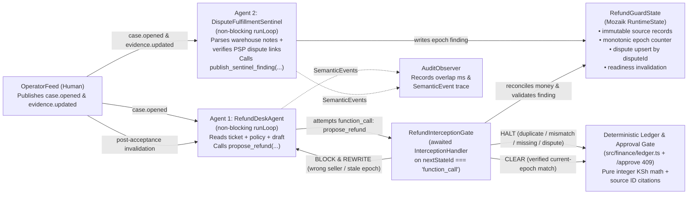

# RefundGuard

**Concurrent Mozaik AI agents with awaited pre-execution interception and server-enforced epoch approvals that prevent wrong-seller refund misallocations, unreconciled clearances, stale post-acceptance approvals, and unsafe cross-system refund proposals before marketplace payouts release.**

| Project Detail | Value |
| :--- | :--- |
| **Event & Track** | JigJoy Black Friday AI Hackathon (26-27 November 2026, Agents in Finance) |
| **Runtime** | `@mozaik-ai/core@6.0.0` (TypeScript, Node.js 20+, MIT License) |
| **Concurrency Model** | 2 concurrent `Agent` loops per checkout + shared `RuntimeState` + reactive `SituationHandler`s + awaited `InterceptionHandler` + `AuditObserver` |
| **Approval Safety** | Server-side `POST /api/sessions/:id/approve` enforces current-epoch & verdict eligibility (returns **HTTP 409 Conflict** on stale epochs or held/frozen verdicts) |
| **Automated Verification** | **23 / 23** Vitest tests passing (core cases, money reconciliation, dispute identity & `CLOSED_LOST`/`CLOSED_WON`, direct gate validation, mock parser edge cases, 4-checkout batch, HTTP 409 approval gate) |
| **Zero-Key Reproducibility** | Full test suite, benchmark, and interactive UI run out of the box via a deterministic **rule-based parser** (`npm ci && npm test`); live OpenAI / Anthropic / Gemini enabled automatically via `.env` |
| **Data Safety** | 100% synthetic orders, settlements, warehouse notes, and disputes; no real customer data, accounts, or money movement |

---

## 1. The Finance Problem & Platform Boundary

Traditional payout reconciliation verifies that **totals match** (`sum(seller_payouts) == bank_settlement`), which leaves three high-cost marketplace failure modes exposed:

1. **Zero-Sum Wrong-Seller Misallocation:** A customer buys two KSh 10,000 items from **Seller A** and **Seller B** in checkout `CHK-402`. The processor confirms a KSh 10,000 refund and settles **KSh 90,000** net. The draft pays **A: KSh 60,000 / B: KSh 30,000**, which **balances to the exact shilling (KSh 90,000)** and passes total reconciliation even though warehouse notes prove **Seller A's** jacket returned (supported allocation: **A: KSh 50,000 / B: KSh 40,000**).
2. **Stale Mid-Flight & Post-Acceptance Approvals:** If a late QC warehouse inspection or issuing-bank dispute arrives while review is running (or after an approval was already rendered on screen), any clearance based on the superseded epoch must expire immediately, both inside the agent runtime and at the human approval endpoint (**HTTP 409 Conflict**).
3. **Unsafe Cross-System Refunds & Prior Lost Disputes:** Card processors such as Stripe already restrict refunding a charge directly while a dispute is open ([Stripe Disputes Docs](https://docs.stripe.com/disputes/how-disputes-work#during-the-dispute)), and Adyen validates split instruction syntax rather than physical return truth ([Adyen Split Refunds](https://docs.adyen.com/marketplaces/split-transactions/split-refunds)). In multi-system marketplaces, however, support desks, OMS queues, 3PL warehouse notes, and payout drafts operate separately. RefundGuard deterministically verifies payment-to-dispute linkage (requiring card last-4, explicit `paymentSettlementId`, no conflicting checkout suffix, and amount within capture), freezes both `OPEN` and prior `CLOSED_LOST` matches (preventing double-refunds after a lost chargeback), replaces `OPEN` records when `CLOSED_WON` arrives for the same `disputeId`, asks operators to verify partial/conflicting signals, and ignores unrelated or `CLOSED_WON`/`WITHDRAWN` disputes.

---

## 2. How Our Agents Run Concurrently on Mozaik

RefundGuard runs natively on `@mozaik-ai/core@6.0.0`'s reactive concurrency primitives to react while work is in flight:



### Mozaik Primitive Mapping

| Mozaik Primitive | Implementation | Role in RefundGuard |
| :--- | :--- | :--- |
| `defineRuntime<RefundGuardState>()` | [`src/mozaik/runtime.ts`](src/mozaik/runtime.ts) | Isolated runtime per checkout session with shared mutable `RefundGuardState` (`epoch`, `sentinelFindings`, `supersededProposals`, dispute upsert by `disputeId`, `interceptions`, `timeline`). |
| Non-blocking `runLoop` + `SituationHandler` | [`src/mozaik/agents/refund-desk.ts`](src/mozaik/agents/refund-desk.ts), [`src/mozaik/agents/sentinel.ts`](src/mozaik/agents/sentinel.ts) | `case.opened` fans out synchronously to both agents, launching two independent `runLoop`s in parallel. `evidence.updated` wakes Sentinel on live updates and triggers RefundDesk revalidation when prior approval is invalidated or an open dispute closes (`CLOSED_WON`). |
| Awaited `InterceptionHandler` | [`src/mozaik/interception.ts`](src/mozaik/interception.ts) | Passed as the 4th argument to `RefundDeskAgent`'s `runLoop`. Hooks `nextStateId === "function_call"` (`propose_refund`), blocks duplicate proposals in an already-accepted epoch, performs a bounded wait for Sentinel on the latest `epoch`, validates money reconciliation and every Sentinel/Desk field without draft fallback, and rewrites wrong/stale calls (appending `[call, blockedToolOutput]` for strict OpenAI/Anthropic/Gemini compatibility) or halts fail-closed. |
| `AuditObserver` (`createHuman`) | [`src/mozaik/agents/observer.ts`](src/mozaik/agents/observer.ts) | Listens to `model.answer`, `interception.started`, and `interception.finished` `SemanticEvent`s and measures exact millisecond overlap between both agents inside each checkout. |
| Custom `InferenceRunner` | [`src/mozaik/runner.ts`](src/mozaik/runner.ts) | Auto-selects live Mozaik models (`gpt-5.4-mini`, `claude-haiku-4-5`, `gemini-3.5-flash`, or custom `gpt-4o-mini`) when an API key is set, or falls back to `RefundGuardMockRunner` (a deterministic rule-based parser with limited free-text coverage) for zero-key verification. |

### Core Safety Invariants
1. **Pre-Clearance Money Reconciliation ([`src/finance/ledger.ts`](src/finance/ledger.ts), [`src/engine/run-case.ts`](src/engine/run-case.ts)):** No payout can clear (`READY_FOR_HUMAN_APPROVAL` or `CORRECTED_READY_FOR_APPROVAL`) unless the draft refund amount, seller draft lines, proposed amount, and posted processor refund settlement reconcile to the exact shilling; otherwise the gate fails closed to `HOLD_RECONCILIATION_MISMATCH`.
2. **Strict Sentinel & Proposal Validation ([`src/mozaik/interception.ts`](src/mozaik/interception.ts)):** The gate never blindly trusts Sentinel or RefundDesk. Clearance requires exact `checkoutId`, current `epoch`, `confidence === "HIGH"`, a `verifiedLineId` owned by `verifiedSellerId`, exact match to the latest warehouse `noteId`, zero draft fallback for invalid sellers, and a bounded Sentinel wait (never spinning infinitely). Duplicate `propose_refund` calls in the same epoch are blocked (`DUPLICATE_PROPOSAL_BLOCKED`).
3. **Deterministic Dispute Linkage & Closure ([`src/finance/dispute-match.ts`](src/finance/dispute-match.ts), [`src/mozaik/runtime.ts`](src/mozaik/runtime.ts)):** Verified matches require card last-4, explicit matching `paymentSettlementId`, no conflicting checkout suffix (short suffixes like `"2"` or suffix-only matches never verify), and amount within capture. Both `OPEN` and `CLOSED_LOST` verified matches freeze checkout; `CLOSED_WON` replaces the original `OPEN` record by `disputeId`.
4. **Server-Side Approval Expiry Gate ([`src/server.ts`](src/server.ts)):** Completed sessions remain retained in memory so post-run disputes or corrections still bump `epoch` and invalidate readiness. `POST /api/sessions/:id/approve` rejects stale epochs (`APPROVAL_EXPIRED_STALE_EPOCH`) and held/frozen verdicts (`VERDICT_NOT_APPROVABLE`) with **HTTP 409 Conflict**. Every checkout starts `PENDING` until an operator explicitly signs off.

---

## 3. Quickstart & Reproducibility

Requires **Node.js 20+** (verified on Node 22 & Node 26). No API key is required for full deterministic verification.

```bash
git clone https://github.com/Grolds-Code/refund-guard.git
cd refund-guard
npm ci
```

### Portable Commands (Recommended First)
Using Node's `--import tsx` loader avoids IPC pipe issues that the standalone `tsx` wrapper can hit in restricted environments:

```bash
npm run typecheck                             # Strict TypeScript check (0 errors)
npm test                                      # 23 automated tests (Vitest)
node --import tsx src/compare.ts              # 3-way benchmark (scored on verdict, seller & exact payouts)
node --import tsx src/server.ts               # Interactive UI (desktop & mobile) on http://localhost:3000
node --import tsx src/cli.ts                  # Run all 5 scenarios in terminal
```

Standard npm script aliases (`npm start`, `npm run compare`, `npm run cli`, `npm run trace:live`) are also defined in `package.json`.

### Running With a Real LLM Provider
Copy `.env.example` to `.env` and supply any one of `OPENAI_API_KEY`, `ANTHROPIC_API_KEY`, or `GEMINI_API_KEY`:

```env
OPENAI_API_KEY=sk-...
REFUND_GUARD_MODE=live
REFUND_GUARD_MODEL=gpt-4o-mini
```

Capture a live post-acceptance late-correction expiry trace (real LLM accepts Seller B on epoch 1, `WH-404-V2` expires epoch 1, both agents revalidate to Seller A on epoch 2 with duplicate-proposal blocking enforced):

```bash
node --import tsx src/live-trace.ts case-4-late-correction-midflight --post-acceptance
```

---

## 4. Live LLM Trace Status (`traces/live-run-trace.json`)

The committed trace at [`traces/live-run-trace.json`](traces/live-run-trace.json) was captured earlier against live OpenAI **`gpt-4o-mini`** on `case-2-wrong-seller-zerosum` (`5,454ms` real concurrent overlap: `RefundDesk [34ms..8147ms]` overlapped `DisputeFulfillmentSentinel [37ms..5491ms]`). Full inspection of that earlier trace showed that the model first proposed and accepted `SELLER-A` at `+2831ms`, then called `propose_refund` again with `SELLER-B` (which `RefundInterceptionGate` blocked at `+4466ms`), and then proposed `SELLER-A` again at `+6099ms`.

That observation directly drove two hardened fixes in the current codebase:
1. `RefundInterceptionGate` and `propose_refund` now block duplicate proposals once an epoch is already accepted (`DUPLICATE_PROPOSAL_BLOCKED`), tested directly in `Audit Fix 4A`.
2. `src/live-trace.ts` now defaults to `case-4-late-correction-midflight --post-acceptance` and verifies `noDuplicateAcceptInAnyEpoch`, `expiredPriorAcceptance`, `reconciliationMatched`, and `concurrentOverlapVerified`. Re-run `node --import tsx src/live-trace.ts` with a live API key to capture a fresh post-acceptance expiry trace on the latest commit.

---

## 5. Multi-Checkout Black Friday Batch Desk (`BATCH-BF-2026-01`)

Switch to **Black Friday Batch Desk (4 Checkouts)** in the UI (or call `GET /api/batch`) to execute **4 concurrent checkout reviews** across 8 Kenyan sellers (each checkout runs 2 parallel Mozaik agent loops with measured overlap inside that checkout). Every checkout starts as **`PENDING`** until an operator clicks Approve/Hold/Reject, and the `Approve` button is disabled on held or frozen rows:

| Checkout | Sellers | Case Type | Expected Verdict | Eligible for Approval | Supported Release | Reserve Held |
| :--- | :--- | :--- | :--- | :---: | ---: | ---: |
| `CHK-402` | Nairobi Streetwear Co. / Rift Valley Footwear | Mid-flight QC warehouse correction (`WH-404-V1` -> `WH-404-V2`) | `CORRECTED_READY_FOR_APPROVAL` | Yes | KSh 90,000 | KSh 0 |
| `CHK-518` | Kilimani Audio Ltd / Mombasa Tech Gear | Clean verified electronics return (`AUD-PRO-01`) | `READY_FOR_HUMAN_APPROVAL` | Yes | KSh 95,000 | KSh 0 |
| `CHK-629` | Eldoret Homeware / Kisumu Ceramics Studio | Missing physical return parcel (`WH-629`) | `HOLD_MISSING_EVIDENCE` | No | KSh 40,000 | KSh 8,000 |
| `CHK-741` | Naivasha Coffee Roasters / Nakuru Leathercraft | Active linked PSP dispute (`DSP-741`, Visa 13.3, card `7784`, `STL-PAY-741`) | `FROZEN_DISPUTE_COLLISION` | No | KSh 78,000 | KSh 12,000 |

---

## 6. Three-Way Benchmark (`node --import tsx src/compare.ts`)

`src/compare.ts` scores every run on **verdict, debited seller, AND exact supported seller payout amounts** (without summing artificial penalties across synthetic fixtures). The comparison between `3/5` and `5/5` measures **static `t=0` snapshot review against live mid-flight evidence interception** (it does not isolate agent count alone, since a sequential agent that re-reads state before committing could also observe updated evidence; RefundGuard uses concurrent Mozaik loops + pre-execution interception to react while work is in flight):

| Scenario | Ticket+Draft Baseline *(no warehouse/dispute input)* | `t=0` Snapshot Baseline *(same initial ticket, draft, warehouse, dispute & policy)* | RefundGuard *(2 concurrent Mozaik agents + `InterceptionGate`)* | Overlap |
| :--- | :--- | :--- | :--- | :---: |
| 1. Clean Pass | PASS (`SELLER-A`, A:50k B:40k) | PASS (`SELLER-A`, A:50k B:40k) | PASS (`SELLER-A`, A:50k B:40k) | YES |
| 2. Zero-Sum Trap | FAIL (`SELLER-B`, A:60k B:30k) | PASS (`SELLER-A`, A:50k B:40k) | PASS (`SELLER-A`, A:50k B:40k) | YES |
| 3. Missing Evidence | FAIL (`SELLER-B`, A:60k B:30k) | PASS (`HOLD_MISSING_EVIDENCE`, A:50k B:30k) | PASS (`HOLD_MISSING_EVIDENCE`, A:50k B:30k) | YES |
| 4. Mid-Flight Correction | FAIL (`SELLER-B`, A:60k B:30k) | FAIL (`SELLER-B`, A:60k B:30k stale `epoch 1`) | PASS (`SELLER-A`, A:50k B:40k at `epoch 2`) | YES |
| 5. Dispute Collision | FAIL (`SELLER-A`, A:50k B:40k) | FAIL (`SELLER-A`, A:50k B:40k unsafe refund) | PASS (`FROZEN_DISPUTE_COLLISION`, A:50k B:40k) | YES |
| **Total** | **1 / 5** | **3 / 5** | **5 / 5** | **5 / 5** |

---

## 7. Automated Test Matrix (`npm test`: 23 / 23 Passing)

| Group | Tests | What They Verify |
| :--- | :---: | :--- |
| Core Scenarios (Cases 1-5 + Interactive Flip) | 6 | Clean pass, zero-sum Seller B -> A correction, fail-closed missing evidence, mid-flight epoch 1 -> 2 correction, mid-flight Visa 13.3 dispute freeze, live warehouse note edit flip. |
| Post-Acceptance Invalidation (`Regression 1A-1C`) | 3 | Event-driven warehouse correction & chargeback on `proposal.accepted` invalidate epoch 1 (`readiness.invalidated`), hold non-zero reserve, and return `PENDING_REVALIDATION` if revalidation cannot finish. |
| Money Reconciliation (`Audit Fix 1`) | 1 | KSh 15,000 draft refund against KSh 10,000 posted refund fails closed with `HOLD_RECONCILIATION_MISMATCH` (`reconciliationMatched: false`). |
| Dispute Identity, Closure & Reserve (`Regression 2A-2B`, `Audit Fix 3A-3D`) | 6 | Unrelated dispute ignored; ambiguous dispute asks verification; conflicting explicit `paymentSettlementId`, 1-char suffix `"2"`, and suffix-only disputes never verify; `CLOSED_LOST` blocks double-refund; `CLOSED_WON` replaces original `OPEN` record by `disputeId`; unverified frozen dispute holds both checkout lines without draft fallback. |
| Direct Gate Strictness & Idempotency (`Audit Fix 4A-4B`) | 2 | Blocks duplicate proposals in the same epoch (`DUPLICATE_PROPOSAL_BLOCKED`); rejects wrong checkout, `LOW` confidence, cross-seller line ID, invented note ID, invalid seller `SELLER-Z`, wrong amount, future epoch `99`, and Sentinel timeout without infinite spin. |
| Mock Rule-Based Parser Edge Cases (`Audit Fix 5`) | 1 | Verifies negation (`"did not receive"`), tentative notes (`"tentative... Pending bench open"`), `"Both items received"`, `"Nothing missing"`, and `"customer kept the jacket"`. |
| Baseline, Batch Desk, Live Interrupt & HTTP 409 Gate | 4 | Snapshot vs. live comparison, 4-checkout batch (all start `PENDING`, held/frozen marked `approvable: false`), `onSessionReady` live interrupt, and real HTTP server tests asserting `409 Conflict` on stale post-run epoch and held verdicts plus `200 OK` on current eligible approvals. |

---

## 8. Financial Grounding & Explicit Hold Policy

Every shilling in [`src/finance/ledger.ts`](src/finance/ledger.ts) is computed in integer KSh and cites exact immutable source record IDs (`DRF-*`, `TKT-*`, `STL-*`, `LINE-*`, `WH-*`, `DSP-*`). RefundGuard reports `requestedRefundKsh`, `blockedUnsafeRefundKsh`, `totalWithheldFromGrossKsh`, and `heldReserveKsh` separately:

- **Approved verdicts (`READY_FOR_HUMAN_APPROVAL`, `CORRECTED_READY_FOR_APPROVAL`):** Release full reconciled net settlement (`reconciliationMatched === true`); deduct refund only from the verified seller.
- **Dispute collision (`FROZEN_DISPUTE_COLLISION`) with HIGH-confidence verified returned seller:** Block the unsafe refund proposal (`requestedRefundKsh`) and hold the verified disputed seller's checkout line (plus any already-posted refund against that seller so active/lost dispute reserves never collapse to KSh 0), keeping the undisputed seller clear.
- **Unresolved attribution or mismatch (`HOLD_MISSING_EVIDENCE`, `HOLD_RECONCILIATION_MISMATCH`, `VERIFY_DISPUTE_MATCH`, `PENDING_REVALIDATION`, or `FROZEN_DISPUTE_COLLISION` without a verified returned seller):** Withhold both checkout lines from gross seller payouts (`totalWithheldFromGrossKsh`) rather than guessing from the untrusted draft. `heldReserveKsh` reports the exact cash reserve held out of `netBatchTotalKsh` (net bank settlement after any posted PSP refund).

---

## 9. HTTP / SSE Endpoints (`src/server.ts`)

| Endpoint | Method | Purpose |
| :--- | :---: | :--- |
| `/` | `GET` | Responsive obsidian dark UI (desktop, tablet, and mobile). |
| `/api/health` | `GET` | Runtime status, active mode (`mock` or `live`), model name, loaded counts, and retained session count. |
| `/api/scenarios` | `GET` | All 5 single-checkout scenarios and 4 Black Friday batch checkouts. |
| `/api/run` | `POST` | Runs a checkout concurrently on Mozaik, streaming `session`, `timeline`, and `report` via SSE, and retains the session for post-run webhooks and approval checks. |
| `/api/sessions/:id/inject` | `POST` | Injects a mid-run or post-run warehouse correction or dispute webhook into a session, bumping `epoch` and invalidating stale approvals. |
| `/api/sessions/:id/approve` | `POST` | Server-side approval gate enforcing current-epoch match and verdict eligibility; returns **HTTP 409 Conflict** (`APPROVAL_EXPIRED_STALE_EPOCH` or `VERDICT_NOT_APPROVABLE`) or **HTTP 200 OK**. |
| `/api/batch` | `GET` | Runs 4 concurrent checkout reviews (2 overlapping Mozaik loops inside each checkout); all decisions start `PENDING`. |
| `/api/compare` | `GET` | Executes the 5-case three-way benchmark (`Ticket+Draft` vs. `t=0 Snapshot` vs. `RefundGuard`). |

---

## 10. Project Structure

```text
src/
  finance/
    types.ts           # Immutable source record, dispute match, verdict & ledger types
    dispute-match.ts   # Deterministic payment-to-dispute linkage verifier (OPEN & CLOSED_LOST)
    ledger.ts          # Pure integer-KSh calculator, money reconciliation & hold policy
    fixtures.ts        # 5 core scenarios (Visa 13.3 codes) + unrelated/ambiguous dispute fixtures
    batch.ts           # 4-checkout, 8-seller Black Friday batch fixtures
  mozaik/
    runtime.ts         # RefundGuardState (RuntimeState), epoch, dispute upsert & invalidation
    interception.ts    # Awaited InterceptionHandler on `propose_refund` (idempotent & strict)
    runner.ts          # Dual live LLM / rule-based deterministic MockInferenceRunner config
    agents/
      refund-desk.ts   # Agent 1: ticket + policy -> propose_refund (+ revalidation loop)
      sentinel.ts      # Agent 2: warehouse notes + dispute links -> publish_sentinel_finding
      observer.ts      # AuditObserver measuring concurrent overlap & SemanticEvents
  engine/
    run-case.ts        # Concurrent Mozaik runner + live snapshot handle + readiness invariant
    run-batch.ts       # Concurrent 4-checkout batch runner (all decisions start PENDING)
    baseline.ts        # Ticket-and-Draft Baseline + static t=0 Snapshot Baseline
  cli.ts               # Terminal runner
  compare.ts           # Payout-verified three-way benchmark
  live-trace.ts        # Real LLM verification harness (default: post-acceptance expiry on Case 4)
  server.ts            # Node HTTP + SSE server with retained sessions and 409 /approve gate
public/
  index.html           # Responsive obsidian dark UI with server-enforced approvals
traces/
  live-run-trace.json  # Live OpenAI gpt-4o-mini concurrent trace
tests/
  refund-guard.test.ts # 23 Vitest tests (`npm test`)
LICENSE                # MIT License
```
