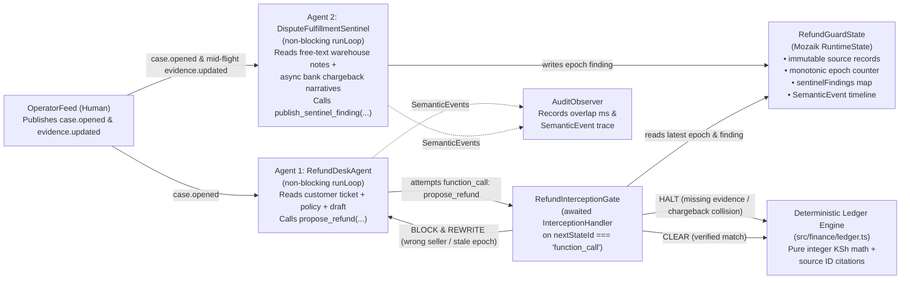

# RefundGuard

**Concurrent Mozaik AI agents with mid-flight `InterceptionHandler` gating that prevent Black Friday double-payouts and wrong-seller refund misallocations before money moves.**

Built solo for the **JigJoy Black Friday AI Hackathon (26-27 November 2026, Agents in Finance)** on `@mozaik-ai/core@6.0.0`.

---

## The Finance Problem

Two costly Black Friday failures slip straight past traditional reconciliation checks:

1. **Zero-Sum Wrong-Seller Misallocation:** A customer buys two KSh 10,000 items from **Seller A** and **Seller B** in one checkout (`CHK-402`). The processor confirms a KSh 10,000 refund and settles **KSh 90,000** for the batch. The payout draft pays **A: KSh 60,000 / B: KSh 30,000**, which **balances exactly to KSh 90,000** and passes batch-total reconciliation, even though an unstructured warehouse return note proves **Seller A's** jacket came back (`A: KSh 50,000 / B: KSh 40,000`).
2. **Mid-Flight Chargeback Double-Payout:** A customer demands an immediate Black Friday refund via support while an asynchronous issuing-bank chargeback webhook (`VISA_13.1`, different external reference ID) arrives mid-review. Without concurrent monitoring and pre-execution interception, the refund desk approves the store refund on top of the open bank dispute, causing an irrecoverable **2x payout loss**.

Neither failure is solved by a ledger total check or a single internal database foreign key: physical warehouse intake notes arrive as unstructured text, and bank chargebacks originate asynchronously outside the store's ticketing system.

---

## How Our Agents Run Concurrently on Mozaik

RefundGuard uses `@mozaik-ai/core@6.0.0`'s core concurrency primitives, not a sequential pipeline and not one chatbot with tools:



### Why Both Agents & Concurrency Are Genuine
- **Two distinct unstructured reasoning tasks:** `RefundDeskAgent` interprets customer support tickets and Black Friday refund policy; `DisputeFulfillmentSentinel` independently interprets free-text warehouse inspection notes (including negation and reused boxes) and correlates external bank chargeback narratives without shared ticket IDs.
- **True non-blocking parallel execution:** Publishing `case.opened` fans out synchronously to both agents' `SituationHandler`s, which launch independent `runLoop`s concurrently. `AuditObserver` measures actual wall-clock overlap between both agents' loop windows on every run (verified `5/5` in tests).
- **Causal mid-flight interception (`InterceptionHandler`):** `RefundDeskAgent` runs with `RefundInterceptionGate` attached as the 4th argument to `runLoop`. Before `propose_refund` can execute, Mozaik pauses the `function_call` transition and awaits `handle()`. The gate inspects `RefundGuardState.epoch` and `DisputeFulfillmentSentinel`'s latest finding:
  - **Wrong seller (`WRONG_SELLER_ALLOCATION`)** or **late correction (`SUPERSEDED_EVIDENCE`, `proposalEpoch < currentEpoch`)** -> blocks the tool call, injects Sentinel's verified findings, and rewrites the transition to `message_received` so Agent 1 re-plans on the latest epoch.
  - **Missing receipt (`MISSING_EVIDENCE`)** or **chargeback collision (`DOUBLE_PAYOUT_BLOCKED`)** -> halts into `model_message` (fail-closed human review); `propose_refund` never executes.

---

## Quickstart (Zero API Key Required)

Requires **Node.js 20+** (tested on Node 22).

```bash
npm install
npm test
```

Run the side-by-side **Single-Agent Baseline vs. Concurrent RefundGuard** benchmark:

```bash
npm run compare
```

Launch the interactive **Live Judge Demo UI**:

```bash
npm start
# Open http://localhost:3000
```

Run the CLI across all 5 cases (or a single case ID):

```bash
npm run cli
npm run cli -- case-4-late-correction-midflight
```

### Live LLM Mode vs. Deterministic Offline Mode
- **Default (`REFUND_GUARD_MODE=auto`):** If `OPENAI_API_KEY`, `ANTHROPIC_API_KEY`, or `GEMINI_API_KEY` is set in `.env`, RefundGuard automatically runs live LLM inference through `@mozaik-ai/core@6.0.0` (`gpt-5.4-mini`, `claude-haiku-4-5`, or `gemini-3.5-flash`).
- **Zero-key judge mode:** When no API key is configured, RefundGuard uses `RefundGuardMockRunner` (a real Mozaik `InferenceRunner` modeled on `mozaik-examples/custom-inference-runner`) that parses the actual warehouse notes, tickets, chargebacks, and interception feedback in the prompt, so **every test, live UI text edit, and mid-flight injection works deterministically offline**.

See [`.env.example`](.env.example) for environment options.

---

## 90-Second Judge Walkthrough

1. Run `npm start` and open `http://localhost:3000`.
2. **Case 2 (Zero-Sum Trap)** runs automatically: the draft balances at **KSh 90,000** (`A: 60k / B: 30k`), both agent lanes stream side-by-side, `RefundInterceptionGate` blocks the Seller B debit, and the grounded ledger corrects payouts to **A: KSh 50,000 / B: KSh 40,000** (same KSh 90,000 total).
3. **Flip an input live:** Click **"Preset: Seller B Boots"** in the warehouse note box (or edit the text yourself) and click **Run Concurrent Review** → watch the interception disappear and the verdict flip cleanly to `READY_FOR_HUMAN_APPROVAL` (`A: 60k / B: 30k`).
4. **Inject a mid-flight bank chargeback:** Set **Mid-Flight Async Event** to **"Inject PSP Chargeback Webhook Mid-Run"** and click **Run Concurrent Review** → watch epoch bump `1 → 2` mid-run, the Sentinel correlate the dispute, and `RefundInterceptionGate` freeze the refund (`FROZEN_DISPUTE_COLLISION`, **KSh 10,000 double-payout prevented**).
5. Click **"Run 5-Case Baseline Benchmark"** or **"Export JSON"** to inspect the complete source-cited evidence bundle.

---

## Fair Baseline Comparison (`npm run compare`)

We compare concurrent **RefundGuard** against a **Single-Agent Sequential Baseline** (`src/engine/baseline.ts`) using the **exact same deterministic ledger calculator and inference runner**, but with a single sequential agent and no concurrent Sentinel or `InterceptionHandler`:

| Scenario | Single-Agent Baseline | RefundGuard (Concurrent Mozaik) | Interception Fired | Concurrent Overlap | Baseline Error | RefundGuard Error |
| :--- | :--- | :--- | :--- | :---: | ---: | ---: |
| 1. Clean Pass | PASS (`SELLER-A`) | PASS (`READY_FOR_HUMAN_APPROVAL`) | none | YES | KSh 0 | KSh 0 |
| 2. Zero-Sum Trap | FAIL (`SELLER-B`) | PASS (`CORRECTED_READY_FOR_APPROVAL`) | `WRONG_SELLER_ALLOCATION` | YES | KSh 10,000 | KSh 0 |
| 3. Missing Evidence | FAIL (`SELLER-B`) | PASS (`HOLD_MISSING_EVIDENCE`) | `MISSING_EVIDENCE` | YES | KSh 10,000 | KSh 0 |
| 4. Mid-Flight Correction | FAIL (`SELLER-B`) | PASS (`CORRECTED_READY_FOR_APPROVAL`) | `SUPERSEDED_EVIDENCE` | YES | KSh 10,000 | KSh 0 |
| 5. Chargeback Collision | FAIL (`SELLER-A`) | PASS (`FROZEN_DISPUTE_COLLISION`) | `DOUBLE_PAYOUT_BLOCKED` | YES | KSh 10,000 | KSh 0 |
| **Total** | **1 / 5 correct** | **5 / 5 correct** | **4 interceptions** | **5 / 5** | **KSh 40,000** | **KSh 0** |

---

## Financial Grounding & Data Safety

- **Zero LLM arithmetic:** All amounts are stored as integer Kenyan Shillings (KSh) and calculated strictly in [`src/finance/ledger.ts`](src/finance/ledger.ts).
- **Source provenance on every figure:** Every seller allocation line cites its exact source record IDs (`DRF-*`, `TKT-*`, `STL-*`, `LINE-*`, `WH-*`, `DSP-*`).
- **Synthetic data only:** All orders, settlements, seller accounts, warehouse logs, and PSP chargebacks are 100% synthetic. No real customer data, no real accounts, and no real money movement occur.

---

## Project Structure

```text
src/
  finance/
    types.ts           # Immutable source record, finding, interception & ledger types
    ledger.ts          # Pure deterministic integer-KSh calculator & citation builder
    fixtures.ts        # 5 synthetic Black Friday scenarios
  mozaik/
    runtime.ts         # RefundGuardState (RuntimeState subclass), epoch & overlap tracker
    interception.ts    # Awaited InterceptionHandler guarding `propose_refund`
    runner.ts          # Dual live LLM / deterministic MockInferenceRunner config
    agents/
      refund-desk.ts   # Agent 1: customer ticket + policy -> propose_refund
      sentinel.ts      # Agent 2: warehouse notes + bank chargebacks -> publish_sentinel_finding
      observer.ts      # AuditObserver tracking concurrent loop overlap & SemanticEvents
  engine/
    run-case.ts        # Concurrent Mozaik orchestrator with live override & injection support
    baseline.ts        # Fair single-agent sequential baseline for comparison
  cli.ts               # Terminal runner (`npm run cli`)
  compare.ts           # Side-by-side benchmark (`npm run compare`)
  server.ts            # Lightweight Node HTTP + SSE server (`npm start`)
public/
  index.html           # Interactive judge demo UI
tests/
  refund-guard.test.ts # 6 proving Vitest tests (`npm test`)
```
