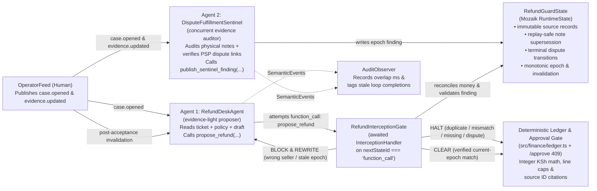

# RefundGuard

**Concurrent Mozaik AI agents with awaited pre-execution interception and server-enforced epoch approvals that prevent wrong-seller refund misallocations, unreconciled clearances, stale post-acceptance approvals, and unsafe cross-system refund proposals before marketplace payouts release.**

| Project Detail | Value |
| :--- | :--- |
| **Event & Track** | JigJoy Black Friday AI Hackathon (26-27 November 2026, Agents in Finance) |
| **Runtime** | `@mozaik-ai/core@6.0.0` (TypeScript, Node.js 20+, MIT License) |
| **Concurrency Model** | 2 concurrent `Agent` loops per checkout (`RefundDeskAgent` evidence-light proposer + `DisputeFulfillmentSentinel` evidence auditor) + shared `RuntimeState` + awaited `InterceptionHandler` + `AuditObserver` |
| **Approval Safety** | Server-side `POST /api/sessions/:id/approve` enforces current-epoch & verdict eligibility in memory (returns **HTTP 409 Conflict** on stale epochs or held/frozen verdicts); Batch Desk triage is clearly labeled as local preview state |
| **Automated Verification** | **32 / 32** Vitest tests passing (core cases, line-level reconciliation & duplicate settlement dedup, dispute identity/closure/out-of-order replay safety, affirmative physical receipt checks, loopId stale tracking, direct gate fuzzing, refreshed sourceCards & HTTP 409 approval gate) |
| **Zero-Key Reproducibility** | Full test suite, benchmark, and interactive UI run out of the box via a deterministic **rule-based parser (limited to tested phrasings)** (`npm ci && npm test`); live OpenAI / Anthropic / Gemini enabled via `.env` |
| **Data Safety** | 100% synthetic orders, settlements, warehouse notes, and disputes; no real customer data, accounts, or money movement |

---

## 1. The Finance Problem & Platform Boundary

Traditional payout reconciliation verifies that **totals match** (`sum(seller_payouts) == bank_settlement`), which leaves three high-cost marketplace failure modes exposed:

1. **Zero-Sum Wrong-Seller Misallocation & Line-Level Over-Refunds:** A customer buys two KSh 10,000 items from **Seller A** and **Seller B** in checkout `CHK-402`. The processor confirms a KSh 10,000 refund and settles **KSh 90,000** net. The draft pays **A: KSh 60,000 / B: KSh 30,000**, which **balances to the exact shilling (KSh 90,000)** and passes total reconciliation even though physical inspection proves **Seller A's** jacket returned (supported allocation: **A: KSh 50,000 / B: KSh 40,000**). Refunds must also never exceed the verified returned order line's refundable amount, duplicate settlement records must not double-count, and unexplained ticket/draft mismatches must fail closed.
2. **Stale Mid-Flight, Post-Acceptance, & Out-of-Order Evidence:** If a late QC warehouse inspection or issuing-bank dispute arrives while review is running (or after an approval was already rendered on screen), any clearance based on the superseded epoch must expire immediately, both inside the agent runtime and at the human approval endpoint (**HTTP 409 Conflict**). Conversely, delayed redelivery of an already-superseded warehouse note (`WH-404-V1` after `WH-404-V2`) or a delayed `OPEN` replay after `CLOSED_WON` must not restore stale state.
3. **Unsafe Cross-System Refunds & Prior Lost Disputes:** Card processors such as Stripe already restrict refunding a charge directly while a dispute is open ([Stripe Disputes Docs](https://docs.stripe.com/disputes/how-disputes-work#during-the-dispute)), and Adyen validates split instruction syntax rather than physical return truth ([Adyen Split Refunds](https://docs.adyen.com/marketplaces/split-transactions/split-refunds)). In multi-system marketplaces, however, support desks, OMS queues, 3PL warehouse notes, and payout drafts operate separately. RefundGuard deterministically verifies payment-to-dispute linkage (card last-4, explicit `paymentSettlementId`, no conflicting checkout suffix, amount within capture), freezes both `OPEN` and terminal `CLOSED_LOST` matches, requires matching payment identity and valid non-terminal transitions before applying `CLOSED_WON`, sizes reserves to the actual disputed amount (holding both sellers on checkout-wide disputes exceeding a single line), and ignores unrelated or already-resolved disputes.

---

## 2. How Our Agents Run Concurrently on Mozaik

RefundGuard runs natively on `@mozaik-ai/core@6.0.0`'s reactive concurrency primitives. To be transparent about responsibilities:
- **`RefundDeskAgent`** is an **evidence-light proposer**: it reads the customer ticket, policy, and payout draft (not warehouse notes) and proposes a seller debit via `propose_refund`.
- **`DisputeFulfillmentSentinel`** runs concurrently in a parallel non-blocking `runLoop`, auditing physical warehouse inspection notes and issuing-bank dispute webhooks and publishing structured findings to shared `RefundGuardState`.
- **`RefundInterceptionGate` + Deterministic Ledger Code** control clearance: the awaited `InterceptionHandler` pauses `propose_refund` before execution, validates every Sentinel and Desk field against immutable source records, reconciles amounts at the verified line level, and blocks/rewrites stale or wrong-seller calls or halts fail-closed.



### Mozaik Primitive Mapping

| Mozaik Primitive | Implementation | Role in RefundGuard |
| :--- | :--- | :--- |
| `defineRuntime<RefundGuardState>()` | [`src/mozaik/runtime.ts`](src/mozaik/runtime.ts) | Isolated runtime per checkout session with shared mutable `RefundGuardState` (`epoch`, replay-safe warehouse supersession, identity-checked terminal dispute transitions, `sentinelFindings`, `supersededProposals`, `interceptions`, `timeline`). |
| Non-blocking `runLoop` + `SituationHandler` | [`src/mozaik/agents/refund-desk.ts`](src/mozaik/agents/refund-desk.ts), [`src/mozaik/agents/sentinel.ts`](src/mozaik/agents/sentinel.ts) | `case.opened` fans out synchronously to both agents, launching two independent `runLoop`s in parallel. `evidence.updated` wakes Sentinel on effective evidence changes and triggers RefundDesk revalidation when prior approval is invalidated or an open dispute validly closes (`OPEN -> CLOSED_WON`). |
| Awaited `InterceptionHandler` | [`src/mozaik/interception.ts`](src/mozaik/interception.ts) | Passed as the 4th argument to `RefundDeskAgent`'s `runLoop`. Hooks `nextStateId === "function_call"` (`propose_refund`), blocks duplicate proposals in an already-accepted epoch, performs a bounded wait for Sentinel, verifies money reconciliation (including verified line refundable cap), validates exact `checkoutId`, `HIGH` confidence, seller-owned `verifiedLineId`, latest `evidenceNoteId`, and known `citedSourceIds`, and rewrites wrong/stale calls (appending `[call, blockedToolOutput]`) or halts fail-closed. |
| `AuditObserver` (`createHuman`) | [`src/mozaik/agents/observer.ts`](src/mozaik/agents/observer.ts) | Listens to `model.answer`, `interception.started`, and `interception.finished` `SemanticEvent`s, records millisecond overlap, and marks superseded loop completion messages as `[STALE epoch X superseded by epoch Y]`. |
| Custom `InferenceRunner` | [`src/mozaik/runner.ts`](src/mozaik/runner.ts) | Auto-selects live Mozaik models (`gpt-5.4-mini`, `claude-haiku-4-5`, `gemini-3.5-flash`, or custom `gpt-4o-mini`) when an API key is set, or falls back to `RefundGuardMockRunner` (a deterministic rule-based parser limited to tested phrasings) for zero-key verification. |

### Core Safety Invariants
1. **Pre-Clearance Line-Level Money Reconciliation ([`src/finance/ledger.ts`](src/finance/ledger.ts), [`src/engine/run-case.ts`](src/engine/run-case.ts)):** Deduplicates settlements by `settlementId` (failing closed on duplicate IDs), enforces `ticket.requestedRefundKsh === draft.refundAmountKsh`, caps refunds at the verified returned order line's refundable amount, validates draft seller deductions both when a refund has posted and when no refund has posted yet (`0` unapplied or exact match), and explicitly reports `pendingRefundKsh` when clearing an unposted refund.
2. **Replay-Safe Evidence & Terminal Disputes ([`src/mozaik/runtime.ts`](src/mozaik/runtime.ts), [`src/finance/dispute-match.ts`](src/finance/dispute-match.ts)):** Ignores redelivered or superseded warehouse notes (e.g., `WH-404-V1` after `WH-404-V2`) and out-of-order timestamps without advancing `epoch`. Dispute closures must match the original dispute's payment identity (`cardLast4`, `paymentSettlementId`, `pspReferenceSuffix`, `amountKsh`); `CLOSED_LOST`, `CLOSED_WON`, and `WITHDRAWN` are terminal (delayed `OPEN` or older `CLOSED_WON` replays are rejected).
3. **Strict Sentinel & Proposal Validation ([`src/mozaik/interception.ts`](src/mozaik/interception.ts)):** Rejects blank/wrong `checkoutId`, `LOW` confidence, cross-seller `verifiedLineId`, stale `evidenceNoteId`, fabricated `citedSourceIds`, invalid seller IDs (zero draft fallback), wrong amounts, future epochs, duplicate same-epoch proposals (`DUPLICATE_PROPOSAL_BLOCKED`), and Sentinel timeouts without infinite spin.
4. **Server-Side Approval Expiry Gate ([`src/server.ts`](src/server.ts)):** Completed single-checkout sessions stay retained in memory (reversible in-memory demo state; no authentication or database persistence). Post-run webhooks bump `epoch`, invalidate prior approvals, and immediately refresh the UI verdict, ledger, and gate. `POST /api/sessions/:id/approve` returns **HTTP 409 Conflict** (`APPROVAL_EXPIRED_STALE_EPOCH` or `VERDICT_NOT_APPROVABLE`) on stale epochs or held/frozen verdicts.

---

## 3. Quickstart & Reproducibility

Requires **Node.js 20+** (verified on Node 22, Node 24 & Node 26). No API key is required for full deterministic verification. All npm runtime scripts invoke `node --import tsx` directly to avoid standalone `tsx` IPC errors.

```bash
git clone https://github.com/Grolds-Code/refund-guard.git
cd refund-guard
npm ci
```

### Verification & Local Run Commands

```bash
npm run typecheck                             # Strict TypeScript check (0 errors)
npm test                                      # 32 automated Vitest tests
npm run compare                               # 3-way benchmark (scored on verdict, seller & exact payouts)
npm start                                     # Interactive UI (desktop & mobile) on http://localhost:3000
npm run cli                                   # Run all 5 scenarios in terminal
```

*(Direct portable invocations such as `node --import tsx src/server.ts` and `node --import tsx src/compare.ts` are identical to the npm scripts above.)*

### Running With a Real LLM Provider
Copy `.env.example` to `.env` and supply any one of `OPENAI_API_KEY`, `ANTHROPIC_API_KEY`, or `GEMINI_API_KEY`:

```env
OPENAI_API_KEY=sk-...
REFUND_GUARD_MODE=live
REFUND_GUARD_MODEL=gpt-4o-mini
```

Capture live traces:

```bash
node --import tsx src/live-trace.ts case-4-late-correction-midflight --post-acceptance
node --import tsx src/live-trace.ts case-2-wrong-seller-zerosum --out traces/live-case2-trace.json
```

---

## 4. Verified Live OpenAI Runs (`traces/`)

Both committed traces were captured on **27 November 2026** against live OpenAI **`gpt-4o-mini`** on the final codebase (with physical-inspection `WH-404-V1` / `WH-404-V2` notes and `loopId`-bound stale observer tracking).

### 4A. Post-Acceptance Expiry & Stale-Loop Tagging (`traces/live-run-trace.json`)
Command: `node --import tsx src/live-trace.ts case-4-late-correction-midflight --post-acceptance` (total duration `8,520ms`; harness injects `WH-404-V2` immediately upon epoch-1 acceptance):

| Timestamp | Epoch | Actor | Observed Event |
| :--- | :---: | :--- | :--- |
| `+41ms` / `+45ms` | 1 | `RefundDeskAgent` & `DisputeFulfillmentSentinel` | Both live `gpt-4o-mini` loops start concurrently on `CHK-402` (`DRF-404` / physical-inspection `WH-404-V1`). |
| `+2908ms` | 1 | `RefundInterceptionGate` | Pauses `RefundDeskAgent`'s `propose_refund(SELLER-B, epoch=1)` for **1,031ms** while awaiting Sentinel. |
| `+3936ms` -> `+3940ms` | 1 | `Sentinel` -> `Gate` -> `RefundDeskAgent` | Sentinel publishes `VERIFIED_RETURN -> SELLER-B (LINE-402-B, WH-404-V1)`; gate clears and epoch 1 accepts `SELLER-B` once. |
| `+3942ms` | 2 | `WarehouseFeed` (harness hook) -> `RefundGuardState` | Injects `WH-404-V2` on `proposal.accepted` (`epoch 1 -> 2`), fires `readiness.invalidated`, moves epoch-1 `SELLER-B` into `supersededProposals`, and launches concurrent epoch-2 loops (`+3942ms` / `+3950ms`). |
| `+5317ms` / `+5518ms` | 2 | `AuditObserver` | Superseded epoch-1 completions are tagged `agent.completed_stale` (`[STALE epoch 1 superseded by epoch 2]`) via exact Mozaik `loopId` binding. |
| `+6350ms` -> `+6652ms` | 2 | `RefundInterceptionGate` -> `Sentinel` -> `RefundDeskAgent` | Gate pauses epoch-2 `propose_refund(SELLER-A, epoch=2)` for **302ms** until Sentinel publishes `VERIFIED_RETURN -> SELLER-A (LINE-402-A, WH-404-V2)`; gate verifies reconciliation & citations and accepts `SELLER-A` once (`CORRECTED_READY_FOR_APPROVAL`). |

**Observed checks (reported without omission):**
- `expiredPriorAcceptance: true` (`supersededProposalCount: 1`, `SELLER-B` at epoch 1 superseded by `SELLER-A` at epoch 2).
- `reconciliationMatched: true` (`A: KSh 50,000 / B: KSh 40,000`, total `KSh 90,000`), `noDuplicateAcceptInAnyEpoch: true`.
- `concurrentOverlapVerified: true` (`RefundDesk [41ms..5317ms]` overlapped `DisputeFulfillmentSentinel [45ms..5518ms]` for `5,272ms`, including awaited gate wait time).
- `wrongProposalBlocked: false` (`interceptions: []`) in this post-acceptance expiry run.

### 4B. Live Zero-Sum Wrong-Seller Interception & Rewrite (`traces/live-case2-trace.json`)
Command: `node --import tsx src/live-trace.ts case-2-wrong-seller-zerosum --out traces/live-case2-trace.json` (total duration `5,709ms`):

| Timestamp | Epoch | Actor | Observed Event |
| :--- | :---: | :--- | :--- |
| `+44ms` / `+48ms` | 1 | `RefundDeskAgent` & `DisputeFulfillmentSentinel` | Both live `gpt-4o-mini` loops start concurrently on `CHK-402` (`DRF-202` / `WH-202`). |
| `+2139ms` | 1 | `RefundInterceptionGate` | Pauses `RefundDeskAgent`'s `propose_refund(SELLER-B, epoch=1)` for **242ms** while awaiting Sentinel. |
| `+2377ms` -> `+2381ms` | 1 | `Sentinel` -> `RefundInterceptionGate` | Sentinel publishes `VERIFIED_RETURN -> SELLER-A (LINE-402-A, WH-202)`; gate **blocks** `SELLER-B` with `WRONG_SELLER_ALLOCATION` (`actionTaken: REWRITE_AND_REPLAN`) and injects structured feedback into the intercepted transition. |
| `+4378ms` -> `+4379ms` | 1 | `RefundDeskAgent` -> `RefundInterceptionGate` | Live `gpt-4o-mini` replans and submits `propose_refund(SELLER-A, epoch=1)`; gate verifies and accepts `SELLER-A` once (`CORRECTED_READY_FOR_APPROVAL`). |

**Observed checks (reported without omission):**
- `wrongProposalBlocked: true` (`interceptions: 1`, reason `WRONG_SELLER_ALLOCATION`, blocked `SELLER-B`, rewritten to `SELLER-A`).
- `reconciliationMatched: true` (`A: KSh 50,000 / B: KSh 40,000`, total `KSh 90,000`), `noDuplicateAcceptInAnyEpoch: true`.
- `concurrentOverlapVerified: true` (`RefundDesk [44ms..5704ms]` overlapped `DisputeFulfillmentSentinel [48ms..3622ms]` for `3,574ms`).
- Duplicate same-epoch blocking (`DUPLICATE_PROPOSAL_BLOCKED`) and mid-flight stale-epoch rewrites are additionally verified deterministically in `npm test` (`Case 4`, `Audit Fix 4A-4B`).

---

## 5. Multi-Checkout Black Friday Batch Desk (`BATCH-BF-2026-01`)

Switch to **Black Friday Batch Desk (4 Checkouts)** in the UI (or call `GET /api/batch`) to execute **4 concurrent checkout reviews** across 8 Kenyan sellers (each checkout runs 2 parallel Mozaik agent loops with measured overlap inside that checkout). Every row starts `PENDING`, held/frozen rows have `Approve` disabled, and Batch Desk triage buttons are explicitly labeled as **local preview state** (server-side HTTP 409 approval enforcement lives on single-checkout sessions via `POST /api/sessions/:id/approve`):

| Checkout | Sellers | Case Type | Expected Verdict | Eligible | Supported Release | Reserve Held |
| :--- | :--- | :--- | :--- | :---: | ---: | ---: |
| `CHK-402` | Nairobi Streetwear Co. / Rift Valley Footwear | Mid-flight QC physical re-inspection (`WH-404-V1` -> `WH-404-V2`) | `CORRECTED_READY_FOR_APPROVAL` | Yes | KSh 90,000 | KSh 0 |
| `CHK-518` | Kilimani Audio Ltd / Mombasa Tech Gear | Clean verified electronics return (`AUD-PRO-01`) | `READY_FOR_HUMAN_APPROVAL` | Yes | KSh 95,000 | KSh 0 |
| `CHK-629` | Eldoret Homeware / Kisumu Ceramics Studio | Missing physical return parcel (`WH-629`) | `HOLD_MISSING_EVIDENCE` | No | KSh 40,000 | KSh 8,000 |
| `CHK-741` | Naivasha Coffee Roasters / Nakuru Leathercraft | Active linked PSP dispute (`DSP-741`, Visa 13.3, card `7784`, `STL-PAY-741`) | `FROZEN_DISPUTE_COLLISION` | No | KSh 78,000 | KSh 12,000 |

---

## 6. Three-Way Benchmark (`npm run compare`)

`src/compare.ts` scores every run on **verdict, debited seller, AND exact supported seller payout amounts** (no artificial penalty sums). The comparison between `3/5` and `5/5` measures **static `t=0` snapshot review against live mid-flight evidence interception** (not agent count alone):

| Scenario | Ticket+Draft Baseline *(no warehouse/dispute input)* | `t=0` Snapshot Baseline *(same initial ticket, draft, warehouse, dispute & policy)* | RefundGuard *(2 concurrent Mozaik agents + `InterceptionGate`)* | Overlap |
| :--- | :--- | :--- | :--- | :---: |
| 1. Clean Pass | PASS (`SELLER-A`, A:50k B:40k) | PASS (`SELLER-A`, A:50k B:40k) | PASS (`SELLER-A`, A:50k B:40k) | YES |
| 2. Zero-Sum Trap | FAIL (`SELLER-B`, A:60k B:30k) | PASS (`SELLER-A`, A:50k B:40k) | PASS (`SELLER-A`, A:50k B:40k) | YES |
| 3. Missing Evidence | FAIL (`SELLER-B`, A:60k B:30k) | PASS (`HOLD_MISSING_EVIDENCE`, A:50k B:30k) | PASS (`HOLD_MISSING_EVIDENCE`, A:50k B:30k) | YES |
| 4. Mid-Flight Correction | FAIL (`SELLER-B`, A:60k B:30k) | FAIL (`SELLER-B`, A:60k B:30k stale `epoch 1`) | PASS (`SELLER-A`, A:50k B:40k at `epoch 2`) | YES |
| 5. Dispute Collision | FAIL (`SELLER-A`, A:50k B:40k) | FAIL (`SELLER-A`, A:50k B:40k unsafe refund) | PASS (`FROZEN_DISPUTE_COLLISION`, A:50k B:40k) | YES |
| **Total** | **1 / 5** | **3 / 5** | **5 / 5** | **5 / 5** |

---

## 7. Automated Test Matrix (`npm test`: 32 / 32 Passing)

| Group | Tests | What They Verify |
| :--- | :---: | :--- |
| Core Scenarios (Cases 1-5 + Interactive Flip) | 6 | Clean pass, zero-sum Seller B -> A correction, fail-closed missing evidence, mid-flight epoch 1 -> 2 physical re-inspection, mid-flight Visa 13.3 dispute freeze, live warehouse note edit flip. |
| Post-Acceptance Invalidation (`Regression 1A-1C`) | 3 | Event-driven warehouse correction & chargeback on `proposal.accepted` invalidate epoch 1 (`readiness.invalidated`), hold non-zero reserve, and fail closed to `PENDING_REVALIDATION` if revalidation cannot finish. |
| Money Reconciliation & Line Caps (`Audit Fix 1`, `Round 2 Fix 3`) | 2 | Draft vs. posted mismatch, refund exceeding verified line cap (15k > 10k), duplicate `STL-REF-402` record, invalid unposted draft deductions (A:55k/B:40k), ticket vs. draft/posted mismatch, explicit `pendingRefundKsh` on unposted approvals, and partial (5k) vs. checkout-wide (20k) dispute reserve sizing. |
| Dispute Identity, Closure & Replay Safety (`Regression 2A-2B`, `Audit Fix 3A-3D`, `Round 2 Fix 1-2`) | 8 | Unrelated/ambiguous matching; conflicting `paymentSettlementId`, 1-char suffix `"2"`, and suffix-only never verify; `CLOSED_LOST` freezes and is terminal; mismatched `CLOSED_WON` rejected; valid `OPEN -> CLOSED_WON` clears freeze and rejects delayed `OPEN` replay; redelivered superseded `WH-404-V1` after `WH-404-V2` ignored without advancing epoch; unverified frozen dispute holds both sellers without draft fallback. |
| Direct Gate Strictness & Idempotency (`Audit Fix 4A-4B`) | 2 | Blocks duplicate same-epoch proposals (`DUPLICATE_PROPOSAL_BLOCKED`); rejects wrong `checkoutId`, `LOW` confidence, cross-seller line ID, stale note ID, invalid seller `SELLER-Z`, wrong amount, future epoch `99`, and Sentinel timeout without infinite spin. |
| Physical Receipt, Non-Return Parser & Gate Citations (`Audit Fix 5`, `Round 2 Fix 4`) | 2 | Verifies negation, tentative/pending notes, `"Both items received"`, `"Nothing missing"`, `"customer kept"`, exterior barcode-only / contents never checked, `"wasn't in the box"`, `"could not locate"`, `"still in transit"`, `"hub has not seen it"`, `"expected tomorrow"`, wrong-brand/wrong-item notes, plus gate rejection of blank `checkoutId` and fabricated `INVENTED-1` citations. |
| Baseline, Batch Desk, Live Interrupt & HTTP 409 Gate | 4 | Snapshot vs. live comparison, 4-checkout batch (all start `PENDING`, held/frozen non-approvable), `onSessionReady` live interrupt, and real HTTP server tests asserting `409 Conflict` on stale post-run epoch and held verdicts plus `200 OK` on current eligible approvals. |
| Final Pre-Submission Blocker Regressions (`Blocker 1-5`) | 5 | Sealed carton + future return promise fail closed; post-run QC correction + dispute does not reuse obsolete `WH-505` finding; out-of-order `CLOSED_WON` (`15:30`) blocks older `OPEN` (`14:30`) and `CHK-402` clears `402`; `loopId`-bound observer tags out-of-order Sentinel completions accurately; `/inject` returns refreshed `sourceRecords` with the newly cited dispute. |

---

## 8. Financial Grounding & Explicit Hold Policy

Every shilling in [`src/finance/ledger.ts`](src/finance/ledger.ts) is computed in integer KSh from deduplicated immutable source records (`DRF-*`, `TKT-*`, `STL-*`, `LINE-*`, `WH-*`, `DSP-*`). RefundGuard reports `requestedRefundKsh`, `pendingRefundKsh`, `blockedUnsafeRefundKsh`, `totalWithheldFromGrossKsh`, and `heldReserveKsh` separately:

- **Approved verdicts (`READY_FOR_HUMAN_APPROVAL`, `CORRECTED_READY_FOR_APPROVAL`):** Release full reconciled net settlement (`reconciliationMatched === true`); deduct refund only from the verified seller (explicitly labeling `pendingRefundKsh` when no processor refund has posted yet).
- **Dispute collision (`FROZEN_DISPUTE_COLLISION`) with HIGH-confidence verified returned seller on the current latest warehouse note and single-line dispute amount:** Block the unsafe refund proposal (`requestedRefundKsh`) and hold the exact disputed amount (plus any already-posted refund against that seller), keeping the undisputed seller clear.
- **Checkout-wide dispute (`dispute.amountKsh > sellerLineAmount`), obsolete warehouse finding, or unresolved attribution/mismatch (`HOLD_MISSING_EVIDENCE`, `HOLD_RECONCILIATION_MISMATCH`, `VERIFY_DISPUTE_MATCH`, `PENDING_REVALIDATION`, or `FROZEN_DISPUTE_COLLISION` without a current verified seller):** Withhold both checkout lines from gross seller payouts (`totalWithheldFromGrossKsh`) rather than guessing from the untrusted draft. `heldReserveKsh` reports the exact cash reserve held out of `netBatchTotalKsh`.

---

## 9. HTTP / SSE Endpoints (`src/server.ts`)

| Endpoint | Method | Purpose |
| :--- | :---: | :--- |
| `/` | `GET` | Responsive obsidian dark UI (desktop, tablet, and mobile). |
| `/api/health` | `GET` | Runtime status, active mode (`mock` or `live`), model name, loaded counts, and retained session count. |
| `/api/scenarios` | `GET` | All 5 single-checkout scenarios and 4 Black Friday batch checkouts. |
| `/api/run` | `POST` | Runs a checkout concurrently on Mozaik, streaming `session`, `timeline`, and `report` via SSE, and retains the session in memory for post-run webhooks and approval checks. |
| `/api/sessions/:id/inject` | `POST` | Injects a mid-run or post-run warehouse correction or dispute webhook into a session, bumping `epoch`, invalidating stale approvals, and returning the refreshed `report` and `sourceRecords` so the UI and evidence cards stay consistent. |
| `/api/sessions/:id/approve` | `POST` | In-memory server-side approval gate enforcing current-epoch match and verdict eligibility; returns **HTTP 409 Conflict** (`APPROVAL_EXPIRED_STALE_EPOCH` or `VERDICT_NOT_APPROVABLE`) or **HTTP 200 OK**. |
| `/api/batch` | `GET` | Runs 4 concurrent checkout reviews (2 overlapping Mozaik loops inside each checkout); all rows start `PENDING` for local triage preview. |
| `/api/compare` | `GET` | Executes the 5-case three-way benchmark (`Ticket+Draft` vs. `t=0 Snapshot` vs. `RefundGuard`). |

---

## 10. Project Structure

```text
src/
  finance/
    types.ts           # Immutable source record, dispute match, verdict & ledger types
    dispute-match.ts   # Deterministic payment-to-dispute linkage verifier (OPEN & CLOSED_LOST)
    ledger.ts          # Pure integer-KSh calculator, line-level reconciliation & dispute reserves
    fixtures.ts        # 5 core scenarios (physical inspection notes & Visa 13.3 codes) + dispute fixtures
    batch.ts           # 4-checkout, 8-seller Black Friday batch fixtures
  mozaik/
    runtime.ts         # RefundGuardState (RuntimeState), replay-safe supersession, loopId & terminal disputes
    interception.ts    # Awaited InterceptionHandler on `propose_refund` (idempotent & strict)
    runner.ts          # Dual live LLM / rule-based deterministic MockInferenceRunner config
    agents/
      refund-desk.ts   # Agent 1 (evidence-light proposer): ticket + policy + draft -> propose_refund
      sentinel.ts      # Agent 2 (concurrent auditor): physical notes + disputes -> publish_sentinel_finding
      observer.ts      # AuditObserver binding exact Mozaik loopId & tagging stale loop completions
  engine/
    run-case.ts        # Concurrent Mozaik runner + live snapshot handle + readiness invariant
    run-batch.ts       # Concurrent 4-checkout batch runner (all rows start PENDING)
    baseline.ts        # Ticket-and-Draft Baseline + static t=0 Snapshot Baseline
  cli.ts               # Terminal runner (`npm run cli`)
  compare.ts           # Payout-verified three-way benchmark (`npm run compare`)
  live-trace.ts        # Real LLM verification harness (`npm run trace:live`)
  server.ts            # Node HTTP + SSE server with retained sessions and 409 /approve gate
public/
  index.html           # Responsive obsidian dark UI with post-run refresh & Try Stale Approval (409)
traces/
  live-run-trace.json   # Live OpenAI gpt-4o-mini post-acceptance expiry trace (Case 4)
  live-case2-trace.json # Live OpenAI gpt-4o-mini wrong-seller interception & rewrite trace (Case 2)
tests/
  refund-guard.test.ts # 32 Vitest tests (`npm test`)
LICENSE                # MIT License
```
