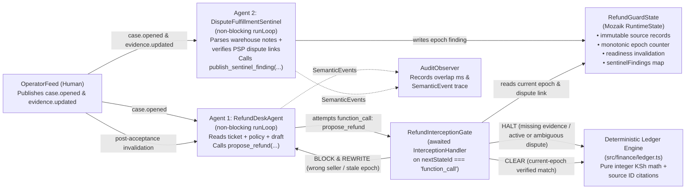

# RefundGuard

**Concurrent Mozaik AI agents with mid-flight `InterceptionHandler` gating that prevent wrong-seller refund misallocations, stale post-acceptance approvals, and unsafe cross-system refund proposals before payouts release.**

Built solo for the **JigJoy Black Friday AI Hackathon (26-27 November 2026, Agents in Finance)** on `@mozaik-ai/core@6.0.0`.

---

## The Finance Problem

Two costly marketplace payout failures slip past standard batch-total reconciliation:

1. **Zero-Sum Wrong-Seller Misallocation:** A customer buys two KSh 10,000 items from **Seller A** and **Seller B** in one checkout (`CHK-402`). The processor confirms a KSh 10,000 refund and settles **KSh 90,000** net for the batch. The payout draft pays **A: KSh 60,000 / B: KSh 30,000**, which **balances exactly to KSh 90,000** and passes batch-total checks, even though unstructured warehouse notes prove **Seller A's** jacket came back (`A: KSh 50,000 / B: KSh 40,000`). If a late QC warehouse correction arrives mid-review or even after initial acceptance, any superseded approval must expire immediately.
2. **Unsafe Cross-System Refund Proposals During Active Disputes:** While card processors such as Stripe already restrict issuing a refund on the same charge once a dispute is open ([Stripe Disputes Docs](https://docs.stripe.com/disputes/how-disputes-work#during-the-dispute)), marketplace support desks, OMS queues, and seller-payout drafts operate across separate systems. RefundGuard verifies payment linkage (`cardLast4`, checkout/settlement reference, amount within capture, and `status === "OPEN"`) before blocking an unsafe cross-system refund or payout proposal, asks an operator to verify ambiguous partial matches, and ignores unrelated or closed disputes.

---

## How Our Agents Run Concurrently on Mozaik

RefundGuard uses `@mozaik-ai/core@6.0.0`'s concurrency primitives, not a sequential pipeline and not one chatbot with tools:



### Key Concurrency & Safety Invariants
- **Two distinct unstructured reasoning tasks:** `RefundDeskAgent` interprets customer support tickets and return policy; `DisputeFulfillmentSentinel` concurrently interprets free-text warehouse intake notes (including negation and reused boxes) and correlates incoming PSP dispute payloads.
- **True non-blocking overlap:** `case.opened` fans out synchronously to both agents' `SituationHandler`s, launching independent `runLoop`s in parallel (`AuditObserver` measures actual wall-clock overlap, verified `5/5`).
- **Pre-execution `InterceptionHandler` (`RefundInterceptionGate`):** Hooks `nextStateId === "function_call"` (`propose_refund`), awaits Sentinel for the latest `epoch`, and blocks/rewrites wrong-seller or stale-epoch proposals or halts fail-closed on missing evidence, active linked disputes, or ambiguous dispute matches.
- **Post-acceptance readiness invalidation:** If relevant evidence changes *after* `proposal.accepted`, `RefundGuardState` immediately archives the prior proposal as superseded, clears readiness, increments `epoch`, and requires revalidation. Before returning any ready verdict, [`runRefundGuardCase`](src/engine/run-case.ts) verifies that both `acceptedProposal.epoch` and `sentinelFinding.epoch` match `state.epoch`; if revalidation cannot complete, it fails closed to `PENDING_REVALIDATION`.

---

## Quickstart (Reproducible Zero-Key Path + Live Model Runner)

Requires **Node.js 20+** (tested on Node 22).

```bash
npm install
npm test          # 12 automated tests (6 core + 6 audit regressions)
npm run compare   # Ticket+Draft vs 1-Agent Snapshot vs Concurrent RefundGuard
npm start         # Interactive dark UI on http://localhost:3000
```

### Launcher Fallback (`node --import tsx`)
If your environment hits an IPC error running the `tsx` CLI directly, invoke Node's loader flag instead:

```bash
node --import tsx src/server.ts
node --import tsx src/compare.ts
node --import tsx src/cli.ts case-4-late-correction-midflight
```

### Live Model Verification (`npm run trace:live`)
- **Offline judge reproducibility (default):** When no API key is configured, RefundGuard runs on `RefundGuardMockRunner` (a Mozaik `InferenceRunner` modeled on `mozaik-examples/custom-inference-runner`) that parses the live prompt text deterministically.
- **Real provider run:** Set `OPENAI_API_KEY`, `ANTHROPIC_API_KEY`, or `GEMINI_API_KEY` in `.env` (see [`.env.example`](.env.example)), then capture a real model trace:

```bash
npm run trace:live
# or fallback:
node --import tsx src/live-trace.ts case-2-wrong-seller-zerosum
```

This runs Case 2 against the configured provider (`gpt-5.4-mini`, `claude-haiku-4-5`, or `gemini-3.5-flash`), verifies that both Mozaik agents invoke their tools, verifies `RefundInterceptionGate` blocks the wrong Seller B proposal and `RefundDeskAgent` submits the revised Seller A proposal, and writes `traces/live-run-trace.json`.

---

## 90-Second Demo Flow

1. Run `npm start` (or `node --import tsx src/server.ts`) and open `http://localhost:3000`.
2. **Open on the KSh 90,000 zero-sum batch (Case 2 / Case 4):** Draft payouts are **A: KSh 60,000 / B: KSh 30,000** (total KSh 90,000). Show the **Concurrent Execution Timeline** where `RefundDeskAgent` and `DisputeFulfillmentSentinel` overlap.
3. **Trigger Case 4 (Mid-Flight Correction):** Watch the QC warehouse correction arrive mid-run (`epoch 1 -> 2`), expire the stale Seller B proposal (`SUPERSEDED_EVIDENCE`), and recompute payouts to **A: KSh 50,000 / B: KSh 40,000** while the batch total stays **KSh 90,000**.
4. **Open "Inspect Source Records":** Show the exact warehouse notes (`WH-404-V1`, `WH-404-V2`) and settlement records (`STL-PAY-402`, `STL-REF-402`) grounding every figure.
5. **Show a negative control:** Switch to **Case 1 (Clean Pass)** and select **"Unrelated dispute (card 8812 / ref 999)"** -> confirm the unrelated dispute is ignored (`READY_FOR_HUMAN_APPROVAL`), or switch to **Case 3 (Missing Evidence)** to show the fail-closed hold.
6. End with `npm test` (12/12 passing) and `npm run compare`.

---

## Fair Baseline Comparison (`npm run compare`)

To avoid conflating evidence access with concurrency, `npm run compare` runs **two explicitly labeled baselines** alongside RefundGuard (without summing artificial penalties across synthetic fixtures):

| Scenario | Ticket-and-Draft Baseline *(no warehouse/dispute feed)* | 1-Agent Snapshot Baseline *(same `t=0` ticket, draft, warehouse, dispute & policy)* | RefundGuard *(2 concurrent Mozaik agents + `InterceptionGate`)* | Concurrent Overlap |
| :--- | :--- | :--- | :--- | :---: |
| 1. Clean Pass | PASS (`SELLER-A`) | PASS (`SELLER-A`) | PASS (`SELLER-A`) | YES |
| 2. Zero-Sum Trap | FAIL (`SELLER-B`) | PASS (`SELLER-A`) | PASS (`SELLER-A`) | YES |
| 3. Missing Evidence | FAIL (`SELLER-B`) | PASS (`HOLD_MISSING_EVIDENCE`) | PASS (`HOLD_MISSING_EVIDENCE`) | YES |
| 4. Mid-Flight Correction | FAIL (`SELLER-B`) | FAIL (`SELLER-B` stale `epoch 1`) | PASS (`SELLER-A` at `epoch 2`) | YES |
| 5. Dispute Collision | FAIL (`SELLER-A`) | FAIL (`SELLER-A` unsafe refund) | PASS (`FROZEN_DISPUTE_COLLISION`) | YES |
| **Score** | **1 / 5** | **3 / 5** *(isolates concurrency to mid-flight Cases 4 & 5)* | **5 / 5** | **5 / 5** |

---

## Financial Grounding & Explicit Hold Policy

- **Zero LLM arithmetic:** All amounts are integer Kenyan Shillings (KSh) computed in [`src/finance/ledger.ts`](src/finance/ledger.ts).
- **Requested Refund vs. Held Reserve:** RefundGuard always reports `requestedRefundKsh` separately from `heldReserveKsh` along with `holdPolicyExplanation`:
  - **Active linked dispute (`FROZEN_DISPUTE_COLLISION`)** with an identified seller line: blocks the unsafe **KSh 10,000** cross-system refund proposal and holds only that seller's disputed **KSh 10,000** checkout line (leaving the undisputed seller's KSh 40,000 payout clear).
  - **Missing evidence / ambiguous dispute / pending revalidation:** holds unsettled checkout lines in reserve because seller attribution is unresolved, while clearly displaying the **KSh 10,000** requested refund separately.
- **Synthetic data only:** All orders, settlements, seller accounts, warehouse notes, and disputes are synthetic. No real accounts or money movement occur.

---

## Project Structure

```text
src/
  finance/
    types.ts           # Immutable source records, dispute match, verdict & ledger types
    dispute-match.ts   # Deterministic payment-to-dispute linkage verifier
    ledger.ts          # Pure deterministic integer-KSh calculator & explicit hold policy
    fixtures.ts        # 5 Black Friday scenarios + unrelated/ambiguous dispute fixtures
  mozaik/
    runtime.ts         # RefundGuardState (RuntimeState), epoch & readiness invalidation
    interception.ts    # Awaited InterceptionHandler on `propose_refund`
    runner.ts          # Dual live LLM / deterministic MockInferenceRunner config
    agents/
      refund-desk.ts   # Agent 1: ticket + policy -> propose_refund (+ revalidation loop)
      sentinel.ts      # Agent 2: warehouse notes + dispute links -> publish_sentinel_finding
      observer.ts      # AuditObserver measuring concurrent overlap & SemanticEvents
  engine/
    run-case.ts        # Concurrent Mozaik runner + strict current-epoch readiness invariant
    baseline.ts        # Ticket-and-Draft Baseline + fair 1-Agent Snapshot Baseline
  cli.ts               # Terminal runner (`npm run cli`)
  compare.ts           # Three-way benchmark (`npm run compare`)
  live-trace.ts        # Real provider verification harness (`npm run trace:live`)
  server.ts            # Lightweight Node HTTP + SSE server (`npm start`)
public/
  index.html           # Minimalist obsidian dark-mode interactive demo UI
tests/
  refund-guard.test.ts # 12 Vitest tests (6 core + 6 audit regressions)
```
